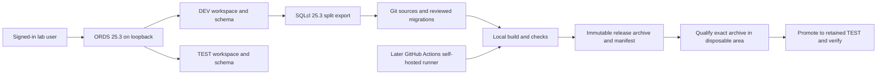
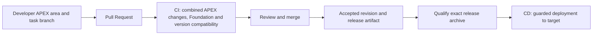
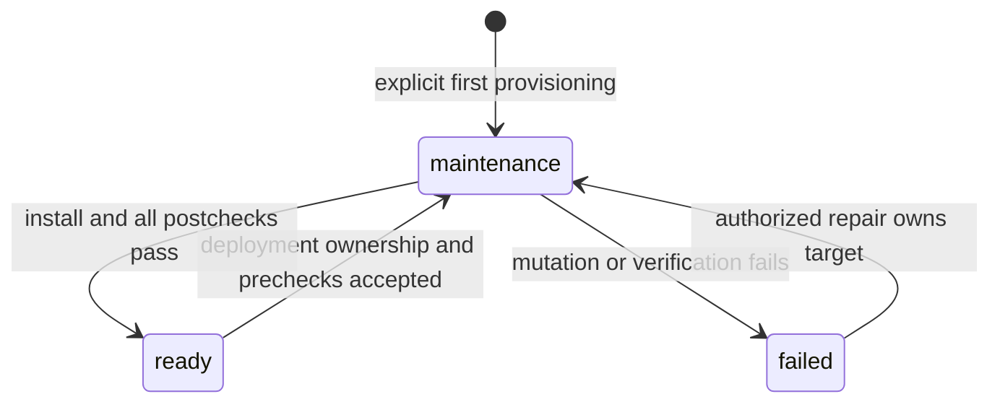

# Candidate architecture

**Delivery principle:** Accepted revisions in the Git repository are the golden source of truth for the engineered CI/CD system. Releases are built from those revisions. Native Oracle APEX Working Copies remain available for break-glass investigation/repair; retained changes return through a reconciliation branch, PR validation and controlled deployment (UC-5).

## Decision status

Accepted as the revised I.1 analysis direction by the Product Owner on 2026-10-16, with the presentation wording correction. This is a direction for Elaboration validation, not a validated architecture baseline or E.1 construction approval. The [SRS](srs.md) owns behavior and scope; the [research](cicd-research.md) owns alternatives and source provenance. PBI-009 owns this document.

## Components and boundaries

I.1 owns [docs/deploy.md](deploy.md) as the infrastructure lifecycle procedure. Elaboration must take this procedure and its supporting scripts as the starting point for creating, verifying, stopping, restarting and destroying the APEX laboratory infrastructure as experiments require. The architecture depends on a reproducible procedure, not on the continued presence of a particular VM or container.

I.1 assessed the procedure on 2026-10-16 against Podman 6.0.0, Oracle AI Database 26ai Free 23.26.3.0.0, APEX 24.2.0 and ORDS 25.3.0.r2671248. The assessed topology uses a dedicated Podman VM, a database container, an ORDS container, a network and persistent volumes; the procedure records their names and image digests. Its resource profile is 4 CPUs, 6144 MiB RAM and 30 GiB sparse disk. These are the analysis reference versions and configuration, not a requirement to retain a running instance.

Before prototype work, E.1 assumes responsibility for execution and any necessary adaptation of the procedure, records the exact tool/image versions and resource ownership, and validates provisioning, access and teardown. Use it to create and destroy identified experiment infrastructure as needed. Teardown applies only to owned disposable resources/data; preserve retained application data, credentials, evidence and unrelated Podman resources. Infrastructure teardown is distinct from a normal application upgrade, which must preserve greeting history. No lifecycle operation is executed by this design update.

Select a single-host proof with A/B/C developer identities, private application/schema/workspace areas, independent Git checkouts and browser sessions, and independently synchronized clients using one shared ownership authority. Keep database and ORDS endpoints on loopback. This proves logical concurrency and ordinary privilege separation, not remote connectivity or isolation from the host owner/platform administrator. Remote shared platforms and independent developer-local instances remain alternatives requiring a revised decision and evidence. Measure resource use before promising simultaneous allocation of all roles.

Target roles are developer areas, a disposable validation area and retained TEST. `LAB_DEV` and `LAB_TEST` are proposed initial mappings in `FREEPDB1`; allocate collision-checked mappings for task areas and validation too. Candidate PR validation and final-release qualification may reuse the disposable area sequentially after a verified reset. They never use TEST's retained schema/application. Each area has dedicated credentials, workspace, schema and application identity; reserve IDs only after checking instance-wide availability and record exact mappings in nonsecret configuration. An assembled target contains one complete APEX application; initial assembly is restricted as defined below. Shared-instance separation does not test database/ORDS upgrade isolation.

The runner executes automation; APEX executes application metadata inside the database. There is no separate application service. No language model, external API or ORDS REST module is needed for greeting behavior.

## Automation tools and interfaces

This inventory implements SRS FR-13. The principal automation path is **runner → project command/script → SQLcl → JDBC/Oracle Net → Oracle Database and public APEX PL/SQL APIs**. APEX application HTTP traffic goes through ORDS. Browser-based App Builder is the developer authoring interface; routine automated delivery uses the command/API path below. Git, the runner, Podman and test clients support the workflow; Oracle tools and supported Oracle interfaces perform APEX/database administration and delivery.

The reference stack is APEX 24.2.0, Oracle Database 23.26.3.0.0 and ORDS 25.3.0.r2671248. SQLcl 25.3.0.274.1210 with Java 21 is the proposed client. The following are selected or candidate mechanisms requiring Elaboration evidence, not working project automation. Public API availability does not establish permissions, completeness or safe failure behavior for our deployment.

1. **AI-1 — Connect and inspect. Tool:** Oracle SQLcl with Java. **Purpose:** execute unattended SQL/PL/SQL and verify target identity/version. **Interface:** JDBC/Oracle Net to the configured PDB service; protected named connections, SQL scripts and dictionary queries. **Access:** dedicated schema credentials for routine operations, separate administrator connection for provisioning. **Elaboration proof:** authenticate noninteractively, verify effective schema/workspace/application mapping, reject a wrong target, redact credentials and propagate connection/SQL errors as nonzero process status.
2. **AI-2 — Provision development/validation areas. Tool:** SQLcl. **Purpose:** create isolated schemas and their APEX workspace mappings. **Interface:** reviewed Oracle user/grant SQL plus public [APEX_INSTANCE_ADMIN.ADD_WORKSPACE](https://docs.oracle.com/en/database/oracle/apex/24.2/aeapi/ADD_WORKSPACE-Procedure.html), then the import path in AI-4. **Access:** explicitly separated database/APEX administration privileges. **Elaboration proof:** provision a collision-checked private area without GUI steps, verify separation, reject name/ID collisions and validate scoped cleanup with disposable fixtures. The complete user/access and cleanup API sequence must be resolved before claiming automated onboarding.
3. **AI-3 — Capture APEX source. Tool:** SQLcl. **Purpose:** initial adoption and capture of browser-authored task changes into the Git checkout. **Interface:** documented [apex export](https://docs.oracle.com/en/database/oracle/apex/24.2/aeadm/exporting-one-or-more-applications.html) with `-applicationid`, `-split`, `-skipExportDate`, `-expOriginalIds`, `-expSupportingObjects N` and a staging `-dir`. **Access:** export rights for the mapped developer application/workspace. **Elaboration proof:** repeatable capture from two private targets, correct identity mapping, page deletion handling and safe managed-tree reconciliation without overwriting unrelated or uncaptured work.
4. **AI-4 — Install application definitions. Tool:** SQLcl. **Purpose:** reconstruct, validate and deploy the accepted APEX sources. **Interface:** public [APEX_APPLICATION_INSTALL](https://docs.oracle.com/en/database/oracle/apex/24.2/aeapi/APEX_APPLICATION_INSTALL.html) context setters for workspace/schema/application ID/alias, followed by execution of the exported `@apex/f<ID>/install.sql`. **Access:** authorized import connection with an already mapped schema/workspace. **Elaboration proof:** fresh import and repeat upgrade, stable IDs/offset handling, correct target settings and a rejected wrong-target attempt. Execute Oracle-generated export scripts as generated; custom automation must not invent calls to internal APEX packages.
5. **AI-5 — Migrate Foundation and component tables/packages. Tool:** Oracle SQLcl's bundled Liquibase. **Purpose:** ordered, recorded database changes. **Interface:** [lb validate and lb update](https://docs.oracle.com/en/database/oracle/sql-developer-command-line/25.3/sqcug/liquibase.html) over JDBC, using the Git changelog and SQL changesets. **Access:** DDL rights limited to the managed schema. **Elaboration proof:** ordered upgrade, repeat execution, retained history and failure after committed DDL; the migration lock must not be mistaken for a full APEX deployment lock.
6. **AI-6 — Detect live drift. Tool:** SQLcl. **Purpose:** compare actual installed definitions with the recorded baseline. **Interface:** public [APEX_EXPORT.GET_APPLICATION](https://docs.oracle.com/en/database/oracle/apex/24.2/aeapi/GET_APPLICATION_Function.html) with `p_type => 'CHECKSUM-SH256'` for APEX metadata; Oracle [DBMS_METADATA](https://docs.oracle.com/en/database/oracle/oracle-database/26/arpls/DBMS_METADATA.html) retrieval and dictionary queries for scoped database definitions. **Access:** authorized APEX export and managed-schema metadata visibility. **Elaboration proof:** unchanged baseline stability, App Builder edits/deletions and separate database drift, with an explicit coverage/normalization profile. Missing metadata visibility must fail the check; APEX checksums do not cover business data or database schema definitions.
7. **AI-7 — Control application availability. Tool:** SQLcl. **Purpose:** pause access for coordinated installation and restore it only after verification. **Interface:** public APEX_APPLICATION_ADMIN [GET_APPLICATION_STATUS](https://docs.oracle.com/en/database/oracle/apex/24.2/aeapi/APEX_APPLICATION_ADMIN.GET_APPLICATION_STATUS-Function.html) and [SET_APPLICATION_STATUS](https://docs.oracle.com/en/database/oracle/apex/24.2/aeapi/APEX_APPLICATION_ADMIN.SET_APPLICATION_STATUS-Procedure.html), with explicit workspace context. **Access:** application administration rights to validate. **Elaboration proof:** maintenance, successful restoration and interrupted/failed deployment; check direct requests and existing sessions. Native whole-application availability is one control, while hierarchical component/page state remains the project mechanism in AI-8.
8. **AI-8 — Enforce ownership, versions, compatibility, state and release guards. Tool:** SQLcl plus project controllers/PL/SQL. **Purpose:** implement the project's delivery policy. **Interface:** proposed project-owned control tables/packages and Oracle transactions/constraints, reached through SQLcl; public APEX metadata reads where needed. **Access:** scoped control-store grants, authenticated ownership and authorized state transitions. The authority is bootstrapped before Foundation and has the separately preserved lifecycle defined below. **Elaboration proof:** atomic Hello reservation, stale-owner/target rejection, complete version checks, inherited state enforcement and failure receipts. These policies are project code to build, not native APEX dependency/state-machine services; the exact shared store and enforcement remain open design work.
9. **AI-9 — Verify the delivered system. Tools:** SQLcl for database assertions; an HTTP client for routes through ORDS; proposed [Playwright](https://playwright.dev/docs/intro) for automated browser behavior. **Purpose:** verify SQL outcomes and actual authenticated page behavior. **Interface:** SQL/PLSQL and the application's normal HTTP/DOM interface. **Access:** dedicated synthetic test identities/fixtures. **Elaboration proof:** headless execution, greetings/history, validation errors, state blocking and useful failure evidence; HTTP success alone is insufficient. Pin the browser runner, Node and browser versions after host compatibility assessment. Playwright is an ancillary non-Oracle test client, not an APEX administration API.
10. **AI-10 — Coordinate Git and infrastructure. Tools:** Git, the selected CI runner and project shell scripts; Podman CLI under [docs/deploy.md](deploy.md). **Purpose:** task branches, artifact packaging, CI/CD execution and scoped infrastructure lifecycle. **Interface:** Git commands/repository-host interfaces and Podman commands; scripts invoke AI-1–9 for Oracle operations. **Access:** separate repository, runtime and database credentials. **Elaboration proof:** noninteractive entry points, same accepted artifact through validation/promotion, scoped create/verify/stop/restart/destroy and retained data/evidence. Git/Podman do not provide APEX import APIs. Remote repository writes remain subject to explicit authorization.

Project scripts must supply scope checks, sequencing, retries/recovery policy, redacted receipts and reliable exit status around these interfaces. No generic REST endpoint for editing/deploying arbitrary APEX pages is assumed, and routine deployment does not automate clicks in App Builder. Any missing supported operation is recorded as a risk and resolved during Elaboration before accepting that part of the architecture. See [the test profile](test-profile.md#automation-interface-validation) for required validation evidence.

## Control model

Git is the authoritative source for accepted application definitions, schema migrations, component versions and state policy. The deployment tool installs reviewed artifacts and records the observed target state. Browser-based editing occurs in developer areas; controlled integration/TEST targets prohibit routine direct editing. Native Working Copies remain a break-glass option. Changes made through App Builder or native merges on a controlled target must be detected and reconciled through a PR before normal delivery resumes.

Three safeguards are equally central: semantic versions and interface compatibility establish what may work together; revision/fingerprint checks establish what is actually installed; state controls establish what may run and which deployment/recovery transitions are permitted. None substitutes for the other two.

## Delivery-control bootstrap

Before the first Foundation task, bootstrap a minimal durable ownership/evidence authority from reviewed operational sources. It owns task reservations, deployment generations and attempt receipts and is not replaced by application imports or ordinary Foundation migrations. Foundation still owns the application's installed-component/runtime-state records. The authority is a logically separate lifecycle responsibility, not a fourth versioned application component. A dedicated schema in the same database is a candidate; no separate service/database is required. Exact storage, grants and lock mechanics remain Elaboration choices.

Missing authority blocks task/deployment writes. A shared database outage may stop the whole lab. After restart, retain ownership/failure evidence, inspect actual target state and require safe recovery; do not infer readiness or silently abandon an owner. Prove exclusion across DDL commits, SQLcl subprocesses and disconnects. A transaction row lock on a connection that commits cannot alone guard the entire deployment.

## Three versioned components

By Product Owner direction, Foundation, Hello and World each have explicit versions and declared compatibility with the other components. Foundation owns shared tables, including greeting history and component-version records; Hello and World may own additional tables. Keep this within one APEX application per target initially. Distinct version identities are useful even when one archive deploys the full set.

APEX 24.2 provides an application Version attribute and `#APP_VERSION#` for displaying it. It also provides static application substitution strings. Those are suitable primitives for labels, rather than evidence of an automatic version/dependency manager for arbitrary page groups. Propose `HELLO_VERSION` and `WORLD_VERSION` substitution strings in exported metadata, displayed on their respective areas; retain the application Version for the whole release. See [application definition and substitutions](https://docs.oracle.com/en/database/oracle/apex/24.2/htmdb/editing-application-attributes.html) and [APP_VERSION](https://docs.oracle.com/en/database/oracle/apex/24.2/htmdb/using-available-built-in-substitution-strings.html). These custom names and their validation are project conventions.

Keep a small Foundation-owned installed-component registry for the three component identities, with explicit not-installed entries during declared initial assembly and actual versions once installed. Include artifact identity and deployment outcome. A source-controlled release manifest declares the versions being delivered. Validate its values against the APEX labels and the foundation migration's declared version at build time. After deployment, reconcile the installed labels and registry with that same manifest. Labels are release metadata, not editable user configuration. Liquibase changeset history identifies individual migrations; it does not replace the logical component versions.

For the initial lab, propose a short explicit list of approved version triples instead of a general dependency resolver. Each approved triple states a compatible Foundation/Hello/World set and links to its validation evidence. For example, Foundation `1.1.0`, Hello `1.0.1`, World `1.0.0` is an illustrative candidate combination, not an already validated release. This covers all component relationships without requiring pairwise rules or a range language. Additional triples require review and evidence; an unlisted triple is rejected.

Pipeline compatibility is a named pre-deployment step: read the installed set, validate metadata and supported upgrade path, compute the intended final set, and check it against the approved triples before any deployment writes. A fresh installation and deliberately incomplete assembly use the explicit stage contract below. Unknown versions, unexpected absence, metadata drift or unsupported upgrades block deployment with a useful explanation. Do not assume every upgrade to an approved final triple is safe: migrations must cover the actual installed starting version and preserve history.

### Initial assembly and first complete release

A new system starts from a reviewed greenfield seed containing source layout, empty migration root, target/ownership mappings and a constrained assembly manifest; it contains no completed Hello/World behavior. Infrastructure and the delivery-control authority precede task reservation. UC-12 remains the separate path for adopting an actual source application. A's first task implements Foundation and installs it into the identified assembly area. Foundation must reconstruct without undelivered Hello/World-owned objects; its shared contracts must respect that boundary. Wire dependent composition behavior only after its declared dependencies exist, through the required ownership/review path.

The assembly manifest explicitly declares the installed versions and which components are not installed; absence is not a fake semantic version. Foundation-only and subsequent Hello-only/World-only intermediate assembly stages are allowed only for an identified incomplete development/validation target. Keep the root in maintenance, deny incomplete dependent behavior and perform component-specific verification. Foundation may be verified ready locally while the maintenance root continues blocking ordinary use; this completes A's task and releases its reservation without claiming a ready application. The selected verifier exception below applies only after required dependencies are installed and verified.

B/C prepare from the accepted Foundation source baseline and add their own components. Their partial assembly is checked against declared present/absent components and installed dependencies. At first complete release, require the approved Foundation/Hello/World triple and greeting/history checks. Operational TEST promotion requires this complete form. A previously complete target with missing component metadata fails closed; it cannot invoke assembly mode to bypass checks. Initial installation may have no APEX application yet: verify the declared absence and do not call native app-status APIs against a nonexistent app.

Apply Foundation before dependent changes. A coordinated upgrade may temporarily produce a mixed set; keep application access paused during that interval and resume only after compatibility and functional postchecks. Record successfully verified component steps and any partial failure, and never mark the whole release successful early. The registry and labels are not proof against arbitrary manual code edits; out-of-pipeline edits require reconciliation before deployment. No version tables, labels, compatibility code or migrations are implemented in I.1.

## Data and application design

Hello and World each have their own entry and singleton configuration tables. A PL/SQL application package validates component ownership and active/default rules, composes the greeting, and inserts its snapshot in one transaction. History stores the SRS snapshot fields; later edits never recompute old rows. Separate UI processes call the same package rather than duplicating validation in pages. Foreign keys preserve source identity; history snapshots preserve the original visible content. Store UTC-capable timestamp-with-time-zone values and render them with an explicit displayed zone.

Initial seed migrations insert missing seed entries once. Later deployments do not reset component settings or copy DEV runtime data to TEST. Nonsecret environment settings, such as banner/alias, are target configuration distinct from user-maintained component prefixes/defaults. Both are distinct from credentials. A browser test must demonstrate these distinctions.

## Sources, packaging and promotion

Proposed source layout is `apex/f<ID>/` for complete split metadata, `db/changelog.xml` with immutable ordered `db/changes/` SQL, `deploy/` for target guards/import controllers, and `tests/` for executable checks. These are future interfaces, not files created by I.1. Exclude supporting objects from APEX export so schema changes have one migration authority.

Use SQLcl 25.3.0.274.1210 with an isolated Java 21 runtime. Named connections `lab-dev` and `lab-test` must resolve to the intended dedicated schemas, with protected local credential storage and no passwords on process arguments. The test profile specifies the exact proposed command interfaces; E.1 must test the credential mechanism and effective connection identity.

PR checks validate the current combined source candidate; changes to the PR or integration base invalidate that result. After merge, build one immutable archive from the clean accepted revision. Include split APEX files, migrations, controllers/tests and a commit/tool manifest; hash the finished archive externally. Qualify those exact bytes in the disposable validation role, then promote the same bytes to TEST. Qualification records the accepted commit/hash, starting baseline, tool versions and controlled nonsecret target inputs. A changed package, stale/missing evidence or unsupported start blocks promotion. Never re-export DEV during promotion or overwrite an archive to repair it.

An initial-assembly archive is qualified against its declared stage and component-specific checks; that evidence cannot qualify it as a complete operational release. Initially declare only fresh complete installation and one accepted additive upgrade path; final-version compatibility is not proof of a migration path. Qualification proves clean reconstruction and upgrade from that declared baseline with synthetic sentinels. Target mappings and credentials are supplied separately; receipts identify their nonsecret configuration revision. The deployment receipt records the same artifact hash/commit, target, migration IDs, APEX identity, result and any incomplete step. Check integrity and target identity before writes. One owner serializes the whole target deployment; Liquibase's lock covers migrations rather than the APEX import/postchecks.

The guarded deployment sequence is specified in Failure handling below; prechecks, state transitions and fingerprint recording are part of that sequence. Map the target workspace/schema/application ID/alias through `APEX_APPLICATION_INSTALL`; repeat-import offset stability is an E.1 experiment. Oracle's [24.2 install procedure](https://docs.oracle.com/en/database/oracle/apex/24.2/aeadm/installing-an-application.html) defines the supported context APIs. APEX import and database migration are separate failure boundaries. Treat neither as a transaction spanning a release.

## Developer/task integration model

The recommended delivery workflow is **developer task branch → Pull Request → CI validation of the combined candidate → review and merge → CD of the accepted release**. Git is the integration authority. Before merge, CI checks the task against the current target branch, validates Foundation/Hello/ World versions and supported migration paths, imports the combined APEX source in a controlled validation area, and verifies required behavior. A changed PR or target branch requires validation of the updated combination before merge. A failed gate blocks merge; post-merge CD builds/promotes the accepted revision with explicit artifact identity and target controls. No PR, workflow or push is created by this design discussion.

A task may change one Page in Page Designer, several pages, or an entire logical Hello/World module and its database objects. The development change boundary, Git review boundary and deployed release boundary are separate. Full split SQL exports allow focused diffs while the initial release still deploys one complete application per target.

Propose a feature-centric demonstration: two task branches for different components start from the same accepted commit and each maps to private application/schema state. Their integrated SQL is imported and checked before building a release. The infrastructure procedure must support validated task areas in addition to DEV/TEST; exact physical provisioning is an E.1 design decision subject to resource and identity checks. Do not assume multiple workspaces on one instance reproduce the paper's matching-identity independent branch instances. Do not create extra runtimes now.

Native Working Copies are retained for break-glass diagnosis/repair, not the normal release integration path. They are live application-definition copies linked to Main, with native compare/refresh/selective replacement; export is a file snapshot and may be full or partial. Neither automatically clones database tables/data. APEX page locks coordinate browser editing; they do not constitute our deployment lock or reserve business database objects. See [APEX 24.2 Working Copies](https://docs.oracle.com/en/database/oracle/apex/24.2/htmdb/about-working-copies.html) and [page locks](https://docs.oracle.com/en/database/oracle/apex/24.2/htmdb/locking-and-unlocking-a-page.html). Emergency application edits must return through the drift-reconciliation flow below. The shared-DEV model remains a researched alternative, not a second integration authority. Working Copy merge limitations also mean module-version labels must be reconciled explicitly with the reviewed release manifest.

Use a recorded base, task branch and target, stable export options, review, merge/conflict resolution, controlled import and behavior verification, then build from the merged commit. A later central DEV deployment must not overwrite active unexported developer work. Reserve an integration-only area or use an explicit freeze/checkpoint. Preserve internal identities and coordinate new page numbers/names; changes to shared application attributes, module versions, install controllers and schema migrations need cross-task review.

The [research](cicd-research.md) links the PDF's page-level guidance, Oracle 24.2 Working Copy/Component Group/export semantics, independent practical evidence and alternative automation tooling. Same-page text conflicts and clean Git merges both require an APEX import and functional checks. SQL remains the installable authority; optional readable YAML must not drift from it.

## Early component change ownership

Multi-developer operation is central to the design. Its required proof is the SRS A/B/C journey: A delivers Foundation; B and C deliver Hello/World on independent branches; then exactly one of B/C may begin a managed Hello task. Normal parallelism is across components; same-component tasks are serialized at acquisition before editing. Elaboration must demonstrate this behavior rather than treating it as a later enhancement.

The implementor recommends a shared atomic reservation of component change scope at UC-9, before task branch creation, developer-area preparation or browser editing. Foundation, Hello and World are independent reservation scopes. Two tasks requesting Hello cannot both receive ownership, even if they intend to edit different Hello pages; this intentionally replaces the earlier proposal to allow independent same-module page tasks. A task affecting multiple components must acquire its full scope atomically or none. A read dependency on Foundation does not reserve Foundation for editing; changing Foundation requires its own reservation.

Shared semantic ownership is explicit: Foundation owns the shared composition/database contracts. A change to Hello/World-owned pages, objects or navigation entries belongs to that component even if exported under Shared Components. Application-wide security/settings/navigation behavior or delivery-controller behavior requires the complete Foundation/Hello/World reservation set; changing composition requires Foundation plus any other component whose owned definitions change. This uses the three existing scopes, with no fourth reservation type. Reservation scope does not force a version increment on unchanged components; version changes follow actual contract/behavior changes.

Generated include lists, export bookkeeping and the changelog root may be reconciled only by explicit bounded rules preserving reviewed component additions/deletions and migration order. File names or “generated” labels do not authorize arbitrary content. Unknown/shared semantic changes block capture until ownership is resolved. If a task discovers additional scope, pause and preserve work; atomically expand to the full required set or report a conflict. Do not silently grant scope, discard work or hold additional partial reservations while waiting indefinitely. On conflict, retain only original ownership until safe cancellation/retry, and revalidate the accepted base before resuming.

Record component scope, authenticated owner, task, accepted base revision and a unique ownership generation in a shared delivery-control store, outside private task checkouts. Return the successful ownership token or an immediate conflict with current owner/task. Check the token and actual changed scope at capture, PR validation and delivery; a Git branch alone is not ownership. The exact store, transaction and permission enforcement are Elaboration design/validation decisions, not capabilities already implemented here.

Do not set running component state to maintenance merely because a developer has reserved editing: development ownership and runtime availability are distinct. Retain the reservation until verified delivery or explicit safe cancellation; a rejected/lost task cannot clear another task's ownership. Abandonment/reassignment requires inspection and a new ownership generation that invalidates the former owner's token. Never reclaim silently while an owner may still be active. Preserve uncaptured work on cancellation or failed preparation.

Attribute authored changes against the task's recorded base and retain reviewed incorporation/merge provenance. When C updates its World branch with B's accepted Hello revision, that inherited change is not a new Hello edit by C; any further C-authored Hello change still needs Hello ownership. Revalidate the updated candidate and its export mapping. Full-application deployment verifies provenance of accepted changes and live ownership for unfinished tasks; it does not require reacquiring authoring reservations for unchanged or already completed components.

The early authoring reservation is separate from the short-lived target deployment lock and expected-revision/fingerprint guard. B may edit Hello while C edits World, but whole-application deployments remain serialized. A stale target or undeclared dependency change can still fail later gates. Direct App Builder/Git actions outside the tool can bypass authoring coordination; restrict controlled targets, check capture scope and retain drift detection. The analysis promises early rejection of competing managed tasks, not that Git itself forbids a second local branch.

## Initial Git adoption and developer onboarding

UC-12 establishes the application repository/source baseline from an authorized source application when no accepted application source revision is available. Capture the complete APEX definition with a consistent export profile, separately capture the required schema/package/static-resource definitions, and record origin identity, versions and dependency/component metadata. Keep passwords and runtime business data outside source. Create a candidate baseline in the approved repository/source area and reconstruct it in a controlled validation target before review acceptance. The project's process repository may already exist; initial application adoption must not reinitialize or overwrite it. No Git repository, application or baseline commit is created by I.1.

Once the initial baseline is accepted, the golden source is the accepted Git revision and its release references. A developer's APEX database contains editing state until captured and reviewed; a release artifact is derived from Git; target receipts describe observed installation/operational state. A later export does not automatically supersede the accepted revision. A source system that changes during bootstrap needs a consistent recapture, and a populated target needs verified baseline adoption rather than destructive initialization or invented migration history.

UC-8 starts with a developer workstation and requested access. The supported toolset is a browser, local Git, the selected SQLcl/Java versions and project capture/validation interfaces. The selected proof uses operator-provided private areas on the single local platform provisioned under [docs/deploy.md](deploy.md). Independent local installations and remote workstations are alternatives outside the first supported proof. Record permissions, endpoint/access method, versions and resource ownership. Repository-host credentials, developer schema credentials and platform-admin access have separate purposes and remain outside source.

UC-9 first reserves the declared component scope, then associates a local task branch and recorded Git base with its prepared developer source/schema area and application when present before editing. UC-10 captures edits into files for commit/PR. UC-7 integrates the validated candidate, UC-4 deploys the accepted revision, and UC-11 verifies behavior/receipts and refreshes or retires the task area safely. These use cases are specified in the [SRS](srs.md); UC-1 and UC-5 provide Foundation and repair paths. No shared unexported work may be overwritten while preparing the next task.

## Capturing developer changes into a Git branch

The implementor owns this technical recommendation: developers author APEX pages in a private development application, then capture its definitions into a local Git checkout on the task branch. A Git branch contains files/commits, not a live connection to APEX. Saving in Page Designer does not update Git, and switching Git branches does not switch the application installed in the developer's database.

Before editing, reserve the component change scope; after success, create/select the task branch from a recorded accepted commit and install that baseline into the corresponding developer application/schema. Record the branch, base commit and source target mapping together. At the seed/Foundation-only stage, capture reviews database/migration sources and records the declared absence of an APEX application; no export is required from an application that does not exist. Once an application exists, after browser edits capture checks that mapping and checkout state, connects to the developer target with SQLcl, and exports a complete split SQL snapshot into a temporary local directory. It then reconciles only the managed APEX source tree in the checkout, including removed files, without replacing database migrations, unrelated files or uncommitted work. Show the diff for review rather than silently committing it.

The underlying documented operation is SQLcl `apex export` with `-split`, `-skipExportDate`, `-expOriginalIds` and `-expSupportingObjects N`, using the recorded developer application ID and a staging `-dir`. See [APEX 24.2 export options](https://docs.oracle.com/en/database/oracle/apex/24.2/aeadm/exporting-one-or-more-applications.html). This exports APEX metadata; the developer separately authors the ordered database migration and updates affected component-version/compatibility metadata in the same task change. Do not infer a safe database migration from an APEX export.

Review the result with Git, stage the intended files and commit them on the task branch. The developer can then submit the branch through the team's PR process. A one-page fix normally changes that page's split file plus any genuinely dependent metadata; a complete snapshot does not require a whole-module-sized diff. Capture never publishes a branch or opens a PR automatically without explicit authorization.

E.1 must implement and validate this capture interface; it is not a working script today. In particular, `-expOriginalIds` preserves original IDs but must not be treated as proof that different developer application/workspace identities produce an identical source tree. Verify canonical file paths and supported identity mapping with two developer targets before adopting the private-application topology. A second capture without edits should have no unexplained diff; deletion, wrong-source and checkout-conflict cases must not silently damage the branch.

## Drift detection and expected-revision guard

Persist the last successful Git revision, artifact hash, installed component versions, target deployment generation, APEX fingerprint and export profile. Semantic versions describe compatibility; the deployment generation identifies an exact installed revision even if a version is reused or a deployment fails. Every controlled mutation attempt advances/records its generation and outcome; a retry cannot mistake partially changed state for the last successful release. For the initial full-application import, protect the entire target application and relevant schema/dependency state, even when the source change affects one page.

APEX 24.2 provides `APEX_EXPORT.GET_APPLICATION` with `CHECKSUM-SH256`, documented as independent of IDs and comparable across instances/workspaces. This is a recomputed export fingerprint, not an automatically incremented Git revision. After a successful deployment, compute it from the live target and associate it with the accepted release. Before the next deployment, recompute with the same versioned options and compare. Never use only the checksum embedded in an old artifact, a version label or a last-updated timestamp as evidence of current content. See [Oracle's 24.2 export API](https://docs.oracle.com/en/database/oracle/apex/24.2/aeapi/GET_APPLICATION_Function.html).

Pin fingerprint scope: deployable application metadata, explicit supporting object/report/translation/comment choices, excluded export date and audit names/ dates. Keep the profile with the receipt. E.1 must prove stable repeated exports, detection of a page edit with unchanged version, add/delete/shared-component coverage, and the effects of target identity, environment settings and controlled availability changes. Fingerprint the target after legitimate target-specific configuration; do not assume the raw artifact hash equals its installed APEX fingerprint. Changes to normalization/profile or APEX version require a reviewed baseline migration, never silently accepting a new checksum.

APEX checksums cover their export scope, not business tables, data, external packages or every workspace resource. For database objects, compare a scoped, normalized schema-definition baseline separately; Liquibase history alone cannot prove that nobody manually altered an object. Inventory owned objects so additions and deletions are detectable; exclude expected runtime data such as greeting rows, state records and operational receipts. Decide exact snapshot APIs and exclusions in E.1 before claiming schema drift detection works.

Acquire exclusive deployment ownership, then re-read expected versions, generation, actual fingerprints and dependency state before application/schema writes. Retain ownership through postchecks and receipt publication. An external editor does not honor our lock: restrict editing on controlled targets and make any emergency edit mutually exclusive with deployment. A lock used only by our tool is not an atomic protection against unrestricted App Builder/admin writes. If the target differs from the expected starting point, reject the attempt before installation. For example, two tasks start at Hello 1.0.0; after one installs 1.0.1, the other cannot overwrite it using an expectation of 1.0.0. It must refresh/reconcile, pass PR checks again and propose a suitable next version.

On drift, block the deployment attempt and preserve a protected local export, scoped schema differences and receipts. The application is not automatically marked failed: unexpected changes may still be running correctly. An operator chooses to restore the accepted baseline or retain the emergency change. Retention uses a dedicated reconciliation branch with secret/unrelated-change review, required dependency/migration changes, PR validation and controlled redeployment. No automatic baseline reset, Git acceptance, commit, merge or push is permitted. Restoration also requires a reviewed, data-preserving path. First installation needs an explicitly identified empty/new target; missing baseline metadata on an existing target is a blocker, not automatic permission to adopt it.

## Component and page state machine

State is operational metadata for each target, alongside version and artifact identity. Propose the small vocabulary `ready`, `maintenance` and `failed`. A component/page may omit its local state and inherit the nearest explicitly set parent state. The hierarchy is Laboratory application → Foundation, Hello, World → their owned pages/objects. Foundation is also a dependency of Hello and World; dependency state is checked even though it is not their parent. The root must have an explicit state. Missing roots, invalid states or cyclic/ unknown parent relationships block operation rather than silently becoming ready.

Store target state in a Foundation-owned registry, with parent, optional local state, revision, reason, actor and deployment/attempt identity. Record changes as events. Git defines the hierarchy and transition/access rules; the registry records current observed operational state. Importing an artifact must not reset failed/maintenance records to ready. Display local state, resolved state, where it was inherited from, and any blocking ancestor/dependency. These labels are our project metadata, not claimed built-in hierarchical APEX status tags.

For example, Hello is maintenance and its configuration page has no tag: the page inherits maintenance. A World page with no tag inherits World's ready state, but still cannot execute a path requiring failed Foundation services. Propose a safety rule: an explicit child ready tag cannot bypass a failed/maintenance ancestor. Inheritance resolves the label; ancestor/dependency checks determine permission to run. Existing authentication/authorization remains required.

These transitions are proposed application behavior, not RUP sprint states. A rejected precheck records a blocked attempt without changing an otherwise ready target. A failed mutation leaves the affected deployment scope failed or maintenance with a reason; there is no direct failed → ready shortcut. An interrupted owner requires inspection of committed work and an authorized recovery; timeout must not silently restore readiness. Only deployment/recovery operations may set readiness after checks. Normal users cannot change state.

Enforce state on the server for page access and submitted actions, including existing browser sessions; hiding navigation or displaying a badge is insufficient. Coordinate in-flight requests before mutation. Since the initial artifact replaces the full APEX app, use application-wide maintenance for deployment initially; page states still express local availability, but do not imply safe independent page deployment. A failed Foundation blocks its dependent operations. Operator recovery/diagnostics must remain accessible through a controlled separate path.

APEX offers application availability/build-status controls, but these are not this inherited state machine. E.1 must choose and verify the runtime guard and controlled maintenance mechanism. See [APEX 24.2 availability/build status](https://docs.oracle.com/en/database/oracle/apex/24.2/aeadm/changing-build-status-for-multiple-applications.html). Keep changing operational state outside static APEX definitions where practical; if native availability changes affect fingerprints, record/verify their expected transitions explicitly rather than disabling drift checking.

## Verification while ordinary access remains blocked

After installation and preliminary integrity/dependency checks succeed, permit a dedicated authenticated verifier to run real browser checks against the intended behavior. Bind permission to the active target and deployment attempt/generation. It bypasses only that attempt's maintenance gate; unknown state, unrelated failed dependencies, ordinary authorization and business validation still apply. Tests intended to prove state blocking must observe that blocking rather than use the exception to evade it. Native restricted access plus the custom guard is a candidate composition, not a validated mechanism. E.1 must prove the import does not create an unrestricted interval and that stale permission cannot be reused.

Before mutation, stop admitting ordinary work and drain or fence active mutations. Keep ordinary identities, direct requests and existing sessions blocked throughout installation/verification. Identify synthetic verifier rows without changing retained history. Revoke permission on success/failure; after interruption, keep ordinary access blocked until inspected recovery, never publish readiness from a timeout. Missing Foundation/control state fails closed.

Account explicitly for controlled native availability changes in the fingerprint profile and receipt. Verify the final intended availability/configuration and establish its baseline while effective ordinary access remains blocked; publish readiness only when the final checks and receipt agree. If native availability affects the checksum, record the authorized transition and recheck final definitions rather than silently accepting drift. Exact native/custom sequencing and request fencing are mandatory Elaboration experiments; choose a different mechanism if these outcomes cannot be achieved.

## Failure handling and validation decisions

Delivery order is: verify artifact qualification; acquire target ownership; check identity, expected generation, live drift, state and compatibility; validate migrations; enter maintenance and drain/fence affected mutations; apply Foundation and dependent changes; pass preliminary integrity checks; grant restricted verification and check definitions, versions, preserved data and behavior; revoke permission; verify final availability/configuration and capture its fingerprints; publish success/ready and release ownership. Initial assembly completes only its declared component-stage checks and retains root maintenance. Recovery owns the same target scope but uses the explicit inspected starting-state contract below. State publication and receipt consistency must be verified under the chosen implementation, especially when the controller or database connection fails.

On mutation failure, preserve partial-state evidence. Do not clear checksums, unlock an active deployment, edit applied migrations or reset the database. Repair with a reviewed changeset or compatible metadata restoration, preserving history. A clean fingerprint does not prove functional health, and a ready label does not prove that code has not drifted; all gates are required.

### Recovery from a recorded partial attempt

UC-5 recovery links the failed attempt, its immutable artifact, last successful receipt, observed committed work, current generation and live partial definitions. Operator review authorizes a specific observed starting state and repair action; this observation is not a new successful baseline. Under deployment ownership, recheck that exact state before mutation. Logs/checkpoints alone cannot establish what committed after a disconnect. Unexplained later changes, incomplete observation or an unsupported partial state block repair with an actionable diagnosis.

Retry unchanged archive bytes only when inspection proves safe repeat/resume. Corrected code or migrations require a new reviewed immutable artifact, qualified in a disposable reconstruction of the supported partial state. Ordinary qualification against a successful baseline is insufficient. Preserve old success/failure receipts and never edit applied changesets or the original archive. Exercise the chosen committed-DDL failure and supported forward repair; no general arbitrary-state repair engine is promised. Repair executes automatically after the operator's decision and must pass the same maintenance/verification/final-state controls before recording success.

E.1 must validate export stability/coverage, schema drift scope, connection isolation, the A/B/C delivery cycle and early Hello reservation race, version compatibility, stale-target rejection, state inheritance/enforcement, race/interruption handling, repeat deployment and forward repair. None has been executed in I.1. If the controller becomes disproportionate, compare the same slice with PROJECT and return material changes for approval. The [test profile](test-profile.md) defines future cases; the [plan proposal](../progress/I.1/sprint_I.1_proposedchanges.md) preserves E.1's prototype decomposition gate. E.1 is active; its proposed design requires approval before construction.
