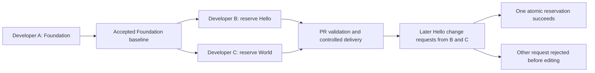

# Software Requirements Specification

**Delivery principle:** The engineered CI/CD system uses accepted revisions in the Git repository as the golden source of truth for application definitions and database migrations. Native Oracle APEX Working Copies are available as a break-glass procedure under UC-5. Any retained emergency change must be captured into Git, reviewed and validated before controlled deployment; it does not bypass repository authority.

## Decision status and system boundary

I.1 analysis baseline accepted by the Product Owner on 2026-10-16, with the presentation wording correction. Derived from the accepted [vision](../README.md). PBI-003 through PBI-008 own this specification; [research](cicd-research.md) and the [candidate architecture](architecture.md) explain its technical direction. This acceptance establishes requirements; executable proof remains due in Elaboration.

The product is a reproducible local APEX/database delivery laboratory, including a minimal example application, reviewable sources, release artifacts, automated checks, controlled DEV-to-user_acceptance_test promotion, and operator guidance. Oracle Database, APEX, ORDS, Podman, Git, and the selected runner are dependencies. Cloud deployment, production service levels, high availability, a business application, and changes to unrelated host resources are outside its boundary.

## Actors

An actor is an external role interacting with the laboratory's application or delivery system. One person may perform several roles. The CI/CD pipeline, capture tool, state registry and managed APEX/database infrastructure are inside the system boundary; they are not external actors in this model.

1. **A-01 — Developer.** Obtains access and a usable workstation/development area; establishes an initial source baseline when needed; starts tasks from accepted Git revisions; edits application/database behavior; captures, commits and submits changes; resolves feedback and verifies delivery. Primary participant in UC-7 through UC-12.
2. **A-02 — Reviewer / integration maintainer (Packager).** Reviews initial baselines and task changes, examines validation evidence, requests corrections and authorizes integration. The development team performs the Packager responsibility: smoke-check the assembled development application and release a reviewed package built from accepted Git source. Supports UC-4, UC-5, UC-7, UC-10 and UC-12.
3. **A-03 — Delivery operator (Deployer).** Provides environment/access, executes the infrastructure lifecycle procedure, establishes or upgrades Foundation, promotes accepted releases, handles drift/state/recovery, and supports developer setup. Primary participant in UC-1, UC-4, UC-5 and UC-6; supports UC-8, UC-9, UC-11 and UC-12.
4. **A-04 — Laboratory application user.** Maintains Hello/World data and configuration, creates greetings and inspects preserved history. Primary participant in UC-2 and UC-3; supports release verification in UC-11.
5. **A-05 — Git hosting service (supporting system actor).** Hosts the shared repository, exposes revisions and PRs, supplies change events and records review/check outcomes. Supports UC-4, UC-7, UC-8, UC-10 and UC-12. Local Git and the project-owned pipeline remain implementation components.

## Stakeholders

The Product Owner defines product intent/priorities and accepts sprint outcomes. That project responsibility is distinct from an operational actor; when reviewing a PR or deploying a release, the person performs A-02 or A-03. A second operator reproducing the example is another participant in A-03, not a different actor type. Actor identification does not imply a production role-management subsystem.

## Complete developer journey

The [E.1 repository and pipeline draft](../progress/E.1/repo_layout.md) maps this journey to the current source layout, private areas and implemented versus planned pipeline paths. The requirements below remain the acceptance authority.

Multi-developer delivery is a core system property. The following journey is its required proof-of-concept acceptance scenario, covering successful parallel work and early rejection of competing changes. Developers A, B and C are three people performing actor A-01. A authors Database Foundation, B authors Hello, and C authors World. A-02 reviews their changes and A-03 operates controlled delivery; a person may perform more than one role, but the responsibilities remain explicit.

The initial supported proof runs on one host with separate A/B/C developer identities, private APEX application/schema areas, independent checkouts/browser sessions and concurrent clients using one ownership authority. Services remain on loopback. It proves logical concurrency and ordinary privilege separation; remote workstation connectivity and isolation from the host/platform administrator are outside this proof. Areas may be allocated sequentially where the experiment permits, while B/C concurrency is exercised genuinely.

### Establish the three components

1. **Onboard A, B and C (UC-8).** Verify the selected host toolset, each developer identity and repository/APEX access, and each private development application/schema.
2. **Establish Git authority when adopting a source application (UC-12).** Capture and verify the initial application/database baseline. Subsequent work starts from its accepted Git revision. For a new system, use a reviewed greenfield seed: source layout, empty migration root, target/ownership mappings and initial-assembly policy, with no prebuilt Hello/World behavior. The delivery-control authority and infrastructure must be bootstrapped before A requests Foundation; UC-12 applies to adoption of an actual source application.
3. **A develops Foundation (UC-9/10).** A requests exclusive change ownership of Foundation, creates a task branch from the accepted base and prepares the corresponding developer area. A authors shared tables/contracts and version metadata, captures/reviews the change and submits a PR.
4. **Review, deliver and verify Foundation (UC-7/4/1/11).** CI validates the candidate; the reviewer accepts it; controlled assembly establishes Foundation and records its verified version/state. Hello/World are explicitly not installed, the application root remains maintenance, and dependent behavior is unavailable. Foundation-specific checks complete A's task without claiming a complete ready release. Release the task's ownership after verified assembly delivery or explicit safe cancellation.
5. **B develops Hello (UC-9/10).** From the accepted Foundation baseline, B reserves Hello, creates its task branch/development area and implements the Hello pages, owned tables/configuration and declared Foundation/interface compatibility. B captures and submits the change.
6. **C develops World (UC-9/10).** C independently reserves World and follows the same cycle. B and C may work in parallel because their reserved components differ. Each validates against current accepted dependencies; neither silently modifies Foundation or the other's component.
7. **Integrate, deliver and verify Hello and World (UC-7/4/11).** Revalidate each PR against current integration sources and compatible component versions, then deploy under exclusive target ownership. Approved intermediate assembly may include Hello or World while the other is explicitly not installed. After both are present, require the approved complete version triple and greeting/history checks (UC-2/3) before the first operational user_acceptance_test release; then release the completed task reservations. Different component tasks may run concurrently; deployments of the full application are serialized.

### B and C concurrently request a Hello change

1. **B and C enter UC-9 against the same accepted Hello revision.** Each names Hello as the intended change scope before branch creation, target preparation or browser editing.
2. **The system atomically grants one reservation.** For this example B wins and receives change ownership tied to Hello, the task and its base revision.
3. **C is rejected immediately.** C sees that Hello is owned by B and cannot start a managed Hello edit. No Hello branch/development target is prepared for C by the tool, no target code is changed, and the running Hello component is not marked failed. If C wins the race, the same rule rejects B.
4. **B completes the normal cycle.** B edits, captures, submits a PR and delivers a validated release. Ownership is rechecked during capture/integration; missing or lost ownership blocks the task. Deployment also checks actual target revision, fingerprints, state and compatibility.
5. **C retries after ownership is safely released.** C starts from the newly accepted Hello revision and obtains a fresh reservation. A stale expectation is rejected; C does not continue from an outdated private snapshot without reconciliation.

**Success criterion:** exactly one simultaneous UC-9 request for Hello succeeds. The losing request fails before managed editing begins and receives the owner/task reason. Hello and World reservations can coexist. A component reservation is an authoring coordination control, not an assertion that arbitrary Git commands or direct App Builder edits are impossible.

### Completion and alternative paths

- **UC-11:** verify the delivered behavior and refresh or retire each task area before the next task.
- **UC-5:** handle drift, stale revisions, failed deployment, lost ownership or abandoned tasks without silently overwriting work or unlocking an active owner.
- **UC-6:** independently reproduce the developer cycle and the same-component rejection case.

## Use cases and success criteria

Identifiers UC-1–7 retain their earlier meanings. UC-8–12 complete the developer journey and bootstrap; their numbers do not prescribe execution order. FR-13 applies across the operational steps of UC-1 through UC-12. The following are Inception specifications of observable behavior. Exact commands, interfaces and implementation mechanisms belong in the architecture/test profile and are validated in Elaboration.

### UC-1 — Establish or upgrade the database foundation

**Primary actor:** A-03 Delivery operator.

**Trigger and preconditions:** The operator identifies a provisioned target, its starting revision and the intended compatible component set.

**Main flow:** The system verifies target identity/state and starting definitions, validates the upgrade path, applies Foundation before dependent changes, and verifies the result.

**Alternative/failure flows:** An unknown/incompatible/stale target blocks installation. A mutation failure enters UC-5 with partial-state evidence.

**Postcondition and success criterion:** The target has the verified installed Foundation/component versions, retained data and a consistent receipt. A declared initial-assembly stage may complete with explicit not-installed components and root maintenance; a complete operational release meets the full compatibility/greeting contract.

**Requirements:** FR-5, FR-6, FR-7, FR-9, FR-10.

### UC-2 — Configure a component

**Primary actor:** A-04 Laboratory application user.

**Trigger and preconditions:** An authenticated user opens an available Hello or World configuration/data area.

**Main flow:** The user selects entries/defaults/prefixes and submits changes. The system validates component ownership and values, saves the valid change and shows the resulting settings.

**Alternative/failure flows:** Invalid/empty required values or an unavailable component reject the operation without a partial save.

**Postcondition and success criterion:** Subsequent greetings use the saved settings; changes to Hello leave World settings/data unchanged.

**Requirements:** FR-1, FR-2, FR-9.

### UC-3 — Record and inspect a greeting

**Primary actor:** A-04 Laboratory application user.

**Trigger and preconditions:** An authenticated user has available, compatible Hello/World components and active entries.

**Main flow:** The user accepts defaults or selects entries, submits a greeting and opens history. The system composes the greeting and saves/displays its immutable snapshot.

**Alternative/failure flows:** Invalid/inactive selections, denied access or blocked component state reject submission without a history row.

**Postcondition and success criterion:** One accepted submission records the exact rendered greeting and required metadata; the row survives refresh, later settings changes and the demonstrated upgrade.

**Requirements:** FR-1, FR-2, FR-3, FR-4, FR-9.

### UC-4 — Deliver a reviewed change

**Primary actor:** A-03 Delivery operator.

**Supporting actors:** A-02 Reviewer and A-05 Git hosting service.

**Trigger and preconditions:** An accepted merged revision, validation evidence and an identified target are available.

**Main flow:** The development team, performing A-02 Packager, supplies one traceable archive built from the accepted revision with development smoke-check and candidate evidence. A-03 Deployer selects that package; the system qualifies those exact bytes in a disposable validation role and promotes the same archive. Candidate PR checks do not replace release integration_test. It obtains target deployment ownership, checks live content/versions/state and the supported starting baseline, applies ordered changes and verifies the result before publishing success.

**Alternative/failure flows:** Failed checks block promotion; unexpected target changes stop before overwrite. A partial mutation invokes UC-5 rather than reporting success.

**Postcondition and success criterion:** user_acceptance_test shows the intended change, compatible versions and ready state, preserved history and the exact source/artifact identity. No re-export from a developer application changes the release.

**Requirements:** FR-4, FR-5, FR-6, FR-7, FR-9, FR-10.

### UC-5 — Reconcile drift or repair a failed delivery

**Primary actor:** A-03 Delivery operator.

**Supporting actors:** A-01 Developer and A-02 Reviewer.

**Trigger and preconditions:** A drift/stale-target check blocks an attempt, or a delivery leaves incomplete/failed state.

**Main flow:** The operator preserves definitions, evidence and retained data, inspects the cause and chooses a reviewed reconciliation or repair. Retained emergency edits enter Git through a PR; an accepted repair is executed through the controlled path and verified. Recovery identifies the failed attempt, current generation, inspected partial definitions and approved repair artifact; under ownership the system rechecks that starting state. Incomplete observation, unsupported repair or later unexplained changes leave recovery blocked. An unchanged archive may be retried only when safe repetition is established; corrected code/migrations require a new reviewed artifact qualified for that partial starting state. Preserve the old successful receipt and failure evidence.

**Alternative/failure flows:** Native Working Copies may support break-glass investigation/repair but do not bypass reconciliation. No suitable safe repair leaves the target blocked with the reason and committed steps recorded.

**Postcondition and success criterion:** Drift is explicitly resolved or the target remains safely blocked. Successful repair preserves history and reconciles source, versions, fingerprints and operational state; retries do not duplicate migrations/seeds.

**Requirements:** FR-4, FR-6, FR-7, FR-9, FR-10.

### UC-6 — Reproduce the laboratory cycle

**Primary actor:** A-03 Delivery operator, performed by a second operator.

**Trigger and preconditions:** The documented source baseline, prerequisites, scoped fixtures and release/failure examples are available.

**Main flow:** The second operator follows onboarding, infrastructure preparation, application delivery and failure/recovery guidance, inspecting results rather than relying only on earlier logs.

**Alternative/failure flows:** Missing prerequisites or unreproducible behavior are recorded as blockers; no success is inferred from a sign-in page alone.

**Postcondition and success criterion:** The operator reaches the documented release, explains its source identity and demonstrates the failure/repair case with retained history and recorded feedback.

**Requirements:** FR-5, FR-6, FR-11, FR-12; NFR-2, NFR-3.

### UC-7 — Review and integrate developer changes

**Primary actor:** A-01 Developer.

**Supporting actors:** A-02 Reviewer and A-05 Git hosting service.

**Trigger and preconditions:** A task branch/PR contains captured application changes, needed migrations and version metadata from an identified baseline.

**Main flow:** The developer submits the change. The system verifies task ownership and declared scope, then validates the combined candidate against current integration sources; the reviewer examines the diff/results and requests corrections or approves merge. The accepted revision becomes available for UC-4.

**Alternative/failure flows:** A changed PR/base requires renewed validation. Different-component changes must retain both developers' intent. Independent tasks modifying different pages of the same component still conflict under the initial component reservation policy; undeclared scope or missing ownership blocks integration. Conflicts from legacy/break-glass work, shared metadata or migrations require explicit resolution and revalidation.

**Postcondition and success criterion:** An approved merged revision contains the intended changes, passes required combined validation and has no unresolved conflicts. Rejected work leaves the accepted baseline unchanged.

**Requirements:** FR-5, FR-7, FR-8, FR-10, FR-11.

### UC-8 — Onboard a developer

**Primary actor:** A-01 Developer.

**Supporting actors:** A-03 Delivery operator and A-05 Git hosting service.

**Trigger and preconditions:** A developer has a workstation and requests participation; project software, credentials or repository access may still be missing.

**Main flow:** The developer obtains the documented repository/APEX permissions, provisions the supported browser/Git/database-client toolset and verifies access. The operator supplies a private development application/schema on the selected single-host platform, prepared through the owned lifecycle procedure. Remote shared-platform and independent developer-local instances remain alternatives requiring a revised topology decision and their own evidence. The system records versions, endpoints, source/development-area identity and access checks; before Foundation assembly, a prepared source/schema area need not contain an application.

**Alternative/failure flows:** A shared platform must still state which application/schema state is private. Missing access, unsupported versions or insufficient local resources stop setup with a clear remedy; no administrative secrets enter Git.

**Postcondition and success criterion:** The developer can authenticate, access project sources and identify a usable authorized development area. Adoption of a source application proceeds to UC-12; a new system starts UC-9 from the reviewed greenfield seed, and ordinary tasks use the accepted application baseline.

**Requirements:** FR-6, FR-11; NFR-1, NFR-2.

### UC-9 — Prepare a task from the accepted baseline

**Primary actor:** A-01 Developer.

**Supporting actors:** A-03 Delivery operator.

**Trigger and preconditions:** Onboarding is complete, the ownership authority is available, and Git contains the reviewed greenfield seed or an accepted application source revision.

**Main flow:** The developer selects the task, complete component change scope and accepted base revision (the reviewed seed for the first Foundation task). The system atomically reserves that scope for the task before creating the local task branch or preparing its developer area. After reservation succeeds, it creates the branch, prepares the private source/schema area and application when that revision contains one, and records owner/task/base/branch/target identity with expected versions and fingerprints.

**Alternative/failure flows:** A reserved component immediately rejects the competing task with its owner/task identity; it does not create a branch/target or mark the running component failed. Multi-component changes reserve their complete scope atomically or obtain none. Wrong target, stale base, drift or failed preparation blocks progression; preserve uncaptured work and release only the rejected task's safe reservation.

**Postcondition and success criterion:** The developer has exclusive task ownership of the declared component scope, and its branch/development area represent the same identified base, including declared absence of an application at the seed stage. Exactly one conflicting reservation succeeds; a different component may be reserved by another developer.

**Requirements:** FR-6, FR-7, FR-8, FR-10, FR-11.

### UC-10 — Capture and submit an application change

**Primary actor:** A-01 Developer.

**Supporting actors:** A-02 Reviewer and A-05 Git hosting service.

**Trigger and preconditions:** UC-9 has established exclusive component task ownership, a known base and a developer area; the developer is ready to change a page or module.

**Main flow:** The developer edits and checks behavior in App Builder when an application exists and authors needed database migrations. The first Foundation-only task authors/captures its schema/migration sources without requiring an APEX export from a nonexistent application. When present, the system captures application definitions into the local task checkout and presents a diff including deletions. The developer updates version/compatibility metadata, reviews the files, commits the intended change and submits a PR for UC-7.

**Alternative/failure flows:** Missing/lost ownership, undeclared component changes, wrong source identity, unsafe overwrite, secrets or unexplained export differences block capture/submission. Git updates do not automatically change the developer database; browser saves do not automatically change Git.

**Postcondition and success criterion:** The task commit reproducibly contains the intended application change and required migration/version metadata, with an identifiable base and reviewable PR. No uncommitted developer snapshot becomes a release source.

**Requirements:** FR-5, FR-7, FR-8, FR-11.

### UC-11 — Verify delivery and prepare the next task

**Primary actor:** A-01 Developer.

**Supporting actors:** A-03 Delivery operator and A-04 Laboratory application user.

**Trigger and preconditions:** A delivery receipt identifies the accepted revision/artifact and target outcome.

**Main flow:** The developer inspects the target, exercises the intended behavior and checks retained history/component versions. The system provides results and the accepted revision. The developer then refreshes the task environment from that revision or retires its disposable resources before starting another task.

**Alternative/failure flows:** Failed/missing behavior or inconsistent receipts enter UC-5. Preserve uncaptured work and retained data before refreshing or destroying a developer area.

**Postcondition and success criterion:** The developer can relate observed behavior to the accepted Git/artifact identity, and the next task starts from a known baseline without losing work or retained data.

**Requirements:** FR-4, FR-5, FR-6, FR-9, FR-11.

### UC-12 — Establish the initial Git source baseline from an application

**Primary actor:** A-01 Developer.

**Supporting actors:** A-02 Reviewer, A-03 Delivery operator and A-05 Git hosting service.

**Trigger and preconditions:** A source APEX application is available for authorized read/export, but it has no accepted project source baseline. The intended repository/source location and capture scope are identified.

**Main flow:** The developer identifies the application, workspace/schema, versions and required dependencies and obtains a consistent capture window. The system exports application definitions and captures required schema/package/static-resource definitions separately, keeping credentials and runtime business data out of source. The developer initializes an approved repository or uses its approved source area, reviews the captured definitions and initial component/dependency metadata, and records a candidate baseline commit. The candidate is reconstructed and verified in a controlled target; the reviewer accepts the initial baseline. Its accepted Git revision becomes the golden source for subsequent development and releases.

**Alternative/failure flows:** A repository containing project work is not reinitialized or overwritten. Source changes during capture require a consistent recapture. Missing database dependencies, secrets or a failed reconstruction prevent baseline acceptance. Adoption of a populated target requires explicit baseline verification; it must not rerun destructive creation scripts or silently assert migration history.

**Postcondition and success criterion:** A reviewed initial revision, provenance and reconstruction evidence establish a reproducible application baseline. Thereafter accepted Git revisions define application code; developer databases are workspaces, and live targets are verified installations. Export alone is not proof of a complete baseline.

**Requirements:** FR-5, FR-6, FR-7, FR-10, FR-12; NFR-1, NFR-2.

## Functional requirements

The three logical components are **Database Foundation**, **Hello** and **World**. Foundation owns shared tables, including greeting history and component-version records. Hello and World each own their behavior, configuration and optional tables, and both depend on Foundation. Each has its own patch/minor/major version. Version compatibility applies to the complete three-component combination, including Hello/World compatibility, not just each component's relationship with Foundation. Separate version identities do not require three applications or independently deployed packages.

**FR-1 — Component data.** Hello and World each own a list of entries with a stable ID, required text of 1–100 characters after trimming, and active flag. Each has a data page to add/edit/deactivate entries. Entries referenced by history are not physically deleted in the initial release. Text is plain text, including Unicode; markup is escaped on display.

**FR-2 — Component configuration.** Each component has its own configuration page with an optional plain-text prefix of 0–30 characters and a default active entry. A default must belong to that component and be active. Deactivating the current default is rejected until another active default is saved. Initial seed entries are `Hello` and `World`; both prefixes are empty. There is no cross-component configuration editing through the other component's page.

**FR-3 — Composition.** An authenticated user may accept the defaults or select other active entries. Render each component as its prefix immediately followed by its trimmed entry text, then join Hello and World with one ASCII space. Thus the seed greeting is exactly `Hello World`. Missing/inactive selections, oversized values, and unauthorized requests fail before history insertion. The server validates the current values within the submission transaction.

**FR-4 — History.** Save an immutable snapshot of both selected texts, both prefixes, final greeting, stable source entry IDs, creation timestamp with time zone, and authenticated actor. Show newest first with an ID tie-breaker and pagination. History has no edit/delete UI. A new successful explicit submission creates one row; preventing repeat submissions across separate user actions is outside the initial contract. APEX duplicate-submit protection should cover an accidental resubmission of the same page request.

**FR-5 — Release flow.** Track APEX definitions, database migrations, nonsecret target mappings and environment configuration defaults in Git. Record the full source commit, tool versions, artifact checksum, target, applied migrations, and check outcomes. Deploy database changes before dependent application definitions, then apply target settings and verify behavior. Release defaults must not overwrite user-maintained component data/configuration on upgrade. integration_test and promotion receipts identify the same archive hash, accepted revision, permitted starting baseline and controlled nonsecret inputs; changed bytes or missing integration_test block promotion.

**FR-6 — Isolation and recovery.** Developer areas, disposable candidate/integration_test areas and retained user_acceptance_test have separate application data, credentials, workspaces and application identities. Candidate and integration_test roles may reuse a disposable area after verified reset; unaccepted candidates must not use retained user_acceptance_test. Check the connected schema, workspace and application mapping before writes. Serialize deployments per target. On failure, retain diagnostics, stop promotion, and follow a reviewed repair path that explicitly accounts for committed DDL and retained history.

**FR-7 — Component versions and compatibility.** Label Foundation, Hello and World with their own explicit versions, include them and declared compatibility in release metadata, and expose the installed versions to the operator. Maintain durable database records for all three components. The deployment pipeline reads installed versions and validates the intended final combination against an explicit compatibility declaration before applying changes. Unknown, missing, inconsistent or incompatible metadata fails closed. Check actual post-deployment identities against the release; record partial failures without claiming the intended versions were installed successfully. Patch means a compatible correction, minor a compatible extension, and major a breaking contract change; version numbering alone does not prove compatibility. Initial assembly is an explicit restricted mode: a reviewed stage declares installed component versions and components deliberately not installed. This permits Foundation-only verification and later Hello/World assembly, with the root in maintenance and incomplete dependent behavior blocked. Unknown or unexpectedly missing metadata remains an error. A previously complete target cannot enter initial assembly to excuse missing components; an operational user_acceptance_test release requires all three versions and an approved complete triple.

**FR-8 — Collaboration and merge safety.** Define how a task's Git branch maps to its APEX application and database state, how exports are scoped/reconciled, and how an integrated revision returns to the development environment. Support parallel tasks on different components and focused single-page fixes. Before managed editing, atomically reserve the complete component change scope for one owner/task; competing requests for that component fail in UC-9, even when they name different pages. Verify ownership/scope during capture, integration and deployment; release it only after verified completion or explicit safe cancellation. Coordinate page IDs, shared components, migration order and version metadata. Record the baseline, author/task changes, conflict decisions and merged artifact. Shared assets require explicit semantic ownership; generated export bookkeeping may be reconciled only under declared rules and validation. Newly discovered scope pauses work until the complete expanded reservation succeeds or reports a conflict; preserve work and avoid indefinite hold-and-wait. Distinguish task-authored changes from incorporated accepted changes, and preserve provenance through integration. Full-application deployment requires target ownership and accepted source provenance, not active authoring reservations for every unchanged component. No release is accepted solely because Git merged the text: import the combined sources and verify both intended changes and retained history. Document shared DEV limits separately from private schema/instance isolation; native Working Copies are retained for break-glass use and do not bypass Git/PR integration.

**FR-9 — Component/page state.** Treat operational state as metadata alongside versions and compatibility. Support explicit ready/maintenance/failed states with untagged children inheriting their parent's state. Record and expose state origin, reason and revision per target. Enforce permitted transitions and access on the server; readiness requires verification. The architecture proposes ancestor/dependency blocking and recovery rules. Ordinary artifact imports must not erase live failure/maintenance state. After preliminary installation/integrity checks, a narrowly authorized verifier may exercise the intended behavior while ordinary work remains blocked; its exception covers only the active deployment-maintenance restriction, never unknown state or unrelated failed dependencies. Stop new work and drain/fence active mutations before installation. Interruption must not expose the app or leave reusable verification permission. Publish readiness only with consistent final availability/fingerprint evidence. Component states are distinct from RUP sprint statuses and deployment-attempt outcomes.

**FR-10 — Live drift and stale-target protection.** Before installation, recompute the target APEX fingerprint and scoped schema-definition differences against the last accepted deployed baseline. Validate the expected component versions and exact deployment revision while holding exclusive ownership. Reject stale, unknown or drifted targets without overwrite; two deployments must not both pass a check against the same superseded revision. Restrict out-of-tool edits on controlled targets and coordinate emergency access. Preserve evidence and reconcile through a reviewed Git change or restoration; never silently adopt drift or infer actual content from version labels alone.

**FR-11 — Developer onboarding and task cycle.** Provide a documented path from workstation/access setup to a usable developer application/schema, a recorded Git base/task association, captured source changes, PR feedback, delivery verification and preparation for the next task. Initially support the single-host private-area proof described in the developer journey; verify its prerequisites and shared ownership authority. Additional workstation/topology variants require explicit selection and validation. Preserve uncaptured work and retained data during refresh/teardown.

**FR-12 — Initial source-baseline adoption.** Support establishing the application repository/source area from an authorized initial APEX export plus separately captured database definitions and required dependencies. Record source identity, versions, capture scope and initial component metadata; review for secrets and reconstruct/verify the candidate before accepting it. Once accepted, Git is authoritative for application definitions and migrations; later changes and retained break-glass fixes enter through reviewed branches. Do not overwrite a populated repository, silently adopt target drift, or treat runtime data/state as application source.

**FR-13 — Automated operations through supported interfaces.** All system operations in the delivery lifecycle must be executable by automation using available Oracle tools and supported interfaces for APEX/database access: environment and developer-area preparation, initial capture, task reservation, source export, validation, installation/upgrade, version/compatibility and state handling, drift detection, verification, and controlled recovery/teardown. Given authorized inputs and credentials, execution must not require interactive App Builder administration, manual file transfer or manual SQL steps. Human authoring, review and approval remain explicit actor decisions; after a decision, the operational steps must be automated. Project orchestration may compose Oracle capabilities but must not depend on undocumented APEX internals or direct writes to APEX repository tables. The [automation interface inventory](architecture.md#automation-tools-and-interfaces) identifies the selected tools, purposes, interfaces, permissions and Elaboration proof for this requirement. An operation without a demonstrated supported path remains an architectural gap; do not silently replace it with a manual procedure or claim it validated.

## Quality requirements and initial release

**NFR-1 — Safety and access.** Keep services on loopback and secrets outside Git, artifacts and logs. Routine deployment uses dedicated schema credentials; SYSDBA is restricted to explicit platform provisioning/assessment. Use APEX authentication for the shared lab user role, authorization on page processes, server validation and escaped output. Fine-grained administrator/user roles, public registration and production authentication are excluded.

**NFR-2 — Reproducibility.** Pin tools and dependency checksums; state resource prerequisites and all operational steps. A post-merge archive is built once, qualified as exact bytes and promoted unchanged. PR candidate evidence is a separate gate. Initially support fresh installation and one explicitly declared additive upgrade path; an approved final version triple alone does not establish a supported starting baseline. Repeat deployment preserves existing row contents and migration identity. Export twice without edits and explain any nonsemantic differences.

**NFR-3 — Observable correctness.** Required checks fail with nonzero status and retained, redacted logs. Automate browser behavior checks separately from SQL and platform availability; manual review may supplement those checks. The concrete cases and commands are in the [test profile](test-profile.md); no throughput or production availability claim is required. The initial synthetic dataset is 20 history rows; pagination is checked with 21. Report observed runtime and resource use without inventing a performance service level.

The initial release must satisfy UC-1 through UC-12 and FR-1 through FR-13, including the A/B/C multi-developer journey and exactly-one-winner Hello reservation race. These are core acceptance criteria, not optional enhancements. Priority is: version-compatible isolated deployment and history preservation; component behavior; repeatable reviewed release; failure/repair; independent reproduction. E.1 validates a thin architectural slice, and does not promise the full release. Exclude independent component deployments, multiple APEX apps per target, real personal data, destructive migrations, data export/import between targets, cloud targets, production backups, extra CI platforms, and optional analysis services. Deferred enhancements require a backlog decision.

## Assumptions and risks

**R-1 — Target collision or privilege leakage.** Schema/workspace separation shares one database and administrative boundary. E.1 must verify identity guards, application ID/alias mapping and absence of cross-schema access before promotion. The delivery operator owns the evidence; no physical isolation is claimed.

**R-2 — Partial deployment/data loss.** DDL and APEX imports may leave committed work. E.1 must retain a history sentinel across additive migration, repeat import, intentional failure and forward repair. The developer owns the repair design; destructive migration stays excluded.

**R-3 — Version and tooling mismatch.** SQLcl and compatible host Java are not ready. E.1 records exact versions and validates export/import, Liquibase, network authentication and failure propagation before prototype expansion.

**R-4 — Runner trust and availability.** A self-hosted runner can access local resources and stops when the Mac is unavailable. Limit it to trusted reviewed jobs, serialize writes and keep secrets scoped. The operator validates this before release; local execution is sufficient for the E.1 experiment only.

**R-5 — Infrastructure lifecycle reproducibility.** I.1 owns the infrastructure procedure in [docs/deploy.md](deploy.md), assessed on Podman 6.0.0, database 23.26.3.0.0, APEX 24.2.0 and ORDS 25.3.0.r2671248. Elaboration must take the procedure and supporting sources, validate/adapt provisioning and teardown, and record exact revisions/versions before claiming lifecycle reproducibility. Use scoped create/destroy operations as experiments require; preserve retained data, credentials and unrelated resources. A running instance is not a project prerequisite.

**R-6 — Legal and licensing assumptions.** This is a local synthetic-data lab. The operator must check the applicable Oracle image/tool and runner terms for their intended use and record provenance before redistributing a runtime or tool archive. Distribute project sources and instructions, not Oracle binaries or credentials. No legal suitability conclusion is claimed by this sprint.

**R-8 — Version drift and compatibility declarations.** A manually changed label or stale registry can misrepresent deployed code. E.1 must check source labels, artifact metadata and installed records together, reject unknown combinations, and demonstrate one accepted and one rejected Foundation/Hello/World set. The delivery operator owns the check; declarations need validation evidence.

**R-9 — Lost changes and false isolation.** Early component reservation must reject a competing task before editing and remain valid across capture/PR/delivery. Abandoned owners and out-of-tool edits need explicit recovery; reservation alone does not fence direct editors. Native Working Copy merges and Git merges have different semantics; shared schemas still expose colleagues to DDL. The developer/integration owner must demonstrate A developing Foundation, B and C independently developing Hello/World, early rejection when both request Hello, and deletion/dependency/migration handling. Out-of-tool same-page conflicts require controlled reconciliation rather than weakening the exclusive task-ownership rule. E.1 must validate identity normalization and a feasible task-area topology before promising isolated developer environments. Keep this risk open until actual APEX import and behavior evidence exists.

**R-10 — Drift, racing deployments and unsafe state recovery.** Delivery ownership and attempt evidence must exist before Foundation and survive its upgrades/imports; the selected implementation must preserve exclusion across DDL commits, subprocesses and disconnects. Initial assembly, verification permission and repair starting-state contracts require experiment evidence. A stale check, uncoordinated emergency editor or missing state guard can overwrite changes or expose a partial release. E.1 must prove unchanged-version App Builder drift, scoped database drift, rejection before writes, guarded concurrency, state inheritance, server enforcement and interrupted-deployment recovery. The operator owns the target baseline and recovery evidence. Fingerprint coverage and transition mechanics remain validation risks, not claimed controls.

**R-7 — Usability and scope growth.** Configuration semantics and one shared lab role are proposed decisions requiring Product Owner approval. Confirm them at this design gate; E.1 browser validation must expose confusing behavior.

**R-11 — Incomplete initial capture or developer baseline.** APEX export does not by itself establish a reproducible database/application system. The developer/reviewer must verify required object/static dependencies, consistent source identity, secret handling and a reconstruction from the candidate commit. Elaboration must validate onboarding and the branch-to-developer-area association alongside initial baseline capture, without claiming that a running source application or an export alone is the golden source.
