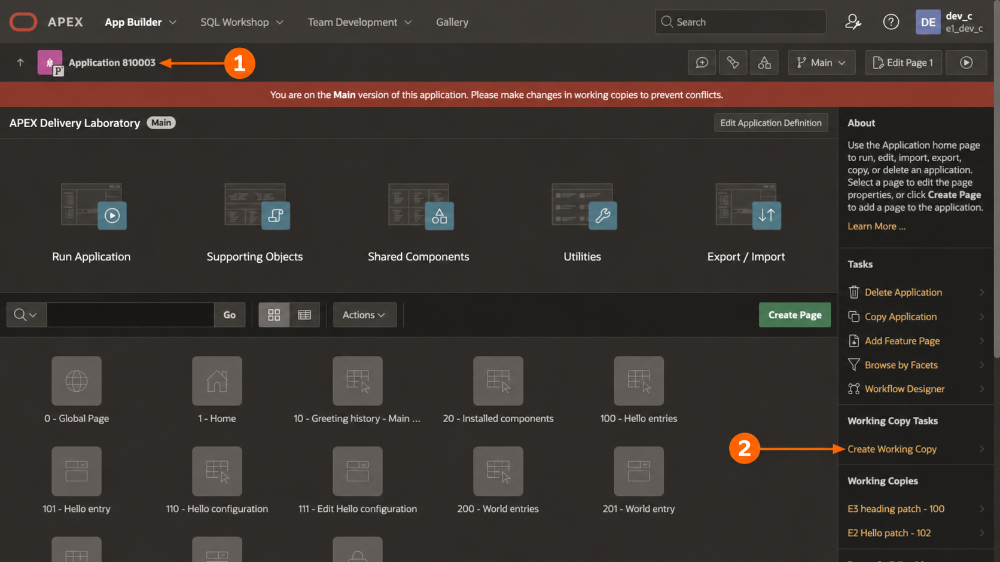
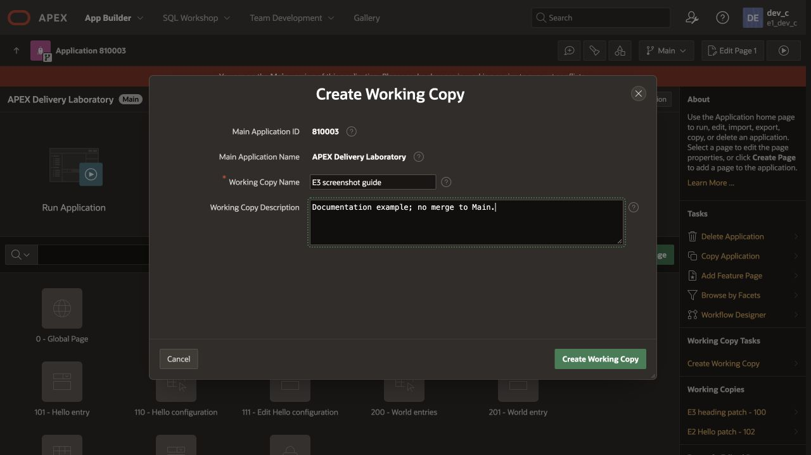
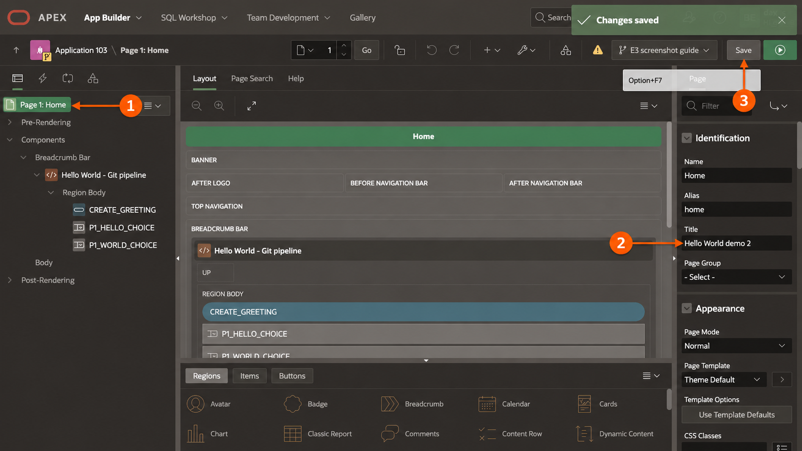
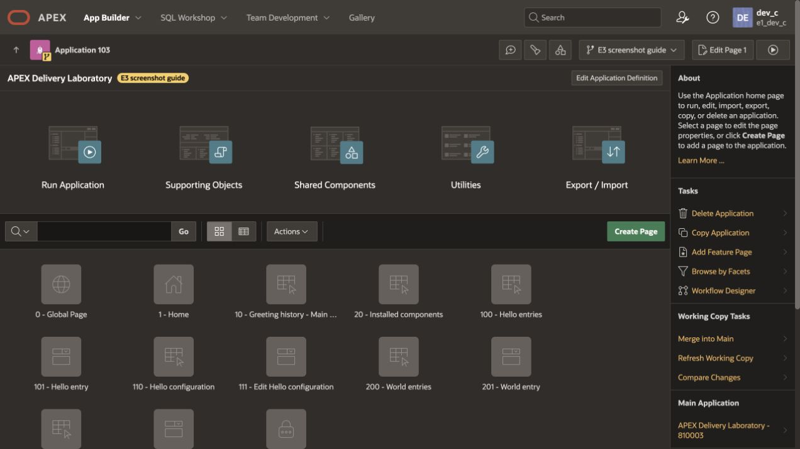
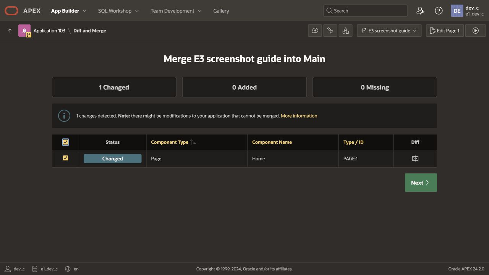
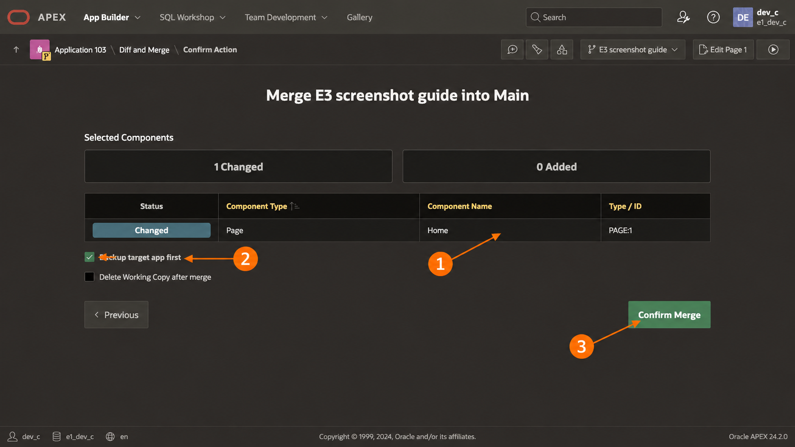

# E.3 — Native Git pipeline walkthrough

**Start here to run the E.3 demonstration manually.** Follow steps A–G below
in order, using the [editable deck](sprint_E.3_increment_demo.pptx) alongside them.
The commands, setup and expected results are included here. The
[operator manual](user_manual.md) is a reference for additional detail, not a
second starting point. The recorded run after step G is historical evidence.

APEX/SQLcl provide native capabilities; GitHub Actions controls execution.

## Run it yourself

### A. Check access and prepare the two checkouts — slides 1–4

This demonstration uses the **existing E.2/E.3 lab**, not a newly provisioned
database. Use its macOS ARM64 host. The startup sequence below brings Oracle up
at `127.0.0.1:1521/FREEPDB1` and ORDS at `http://127.0.0.1:8080/ords`.
You need the existing APEX developer credential for Main 810003 in E1_DEV_C,
the E1_DEV_C and E3_TARGET database passwords, and LAB_USER's target application
password. These are different credentials. The target is E3_TARGET / 810203;
retained UAT is not used.

Install Podman, Git, GitHub CLI (`gh`), jq, curl, nc, tar, unzip and shasum on this host.
For developer capture, Java 21 and SQLcl **25.4.1.022.0618** must also be on
your ordinary PATH. Release jobs install their own Java/SQLcl. Authenticate
`gh` with your GitHub account. The public source is readable by everyone;
creating your own repository and configuring its runner requires your own
repository administration permission.

The software runs in these locations; starting the GitHub runner does not start
the database or web server:

| Location | Required software / resource | Purpose |
|---|---|---|
| macOS host | Podman CLI (demonstrated: 6.0.0) | Starts the Linux VM and its containers |
| macOS host | Git, gh, jq, curl, nc, tar, unzip, shasum | Repository setup, connectivity and runner setup |
| macOS author terminal | Java 21 and SQLcl 25.4.1.022.0618 | Native PROJECT capture, staging and verification |
| Podman VM `apex-cicd` | Prepared Linux container engine; demonstrated sizing: 4 CPUs, 6 GiB RAM, 30 GiB disk | Hosts the two containers |
| Container `apex-db` | Oracle Database Free 23.26.3, with APEX 24.2 installed in FREEPDB1 | Database, APEX definitions and existing lab data |
| Container `apex-ords` | ORDS 25.3 and APEX static assets | Serves App Builder and application HTTP URLs |

If Podman is missing, install the macOS package from the
[official Podman installer](https://podman.io/docs/installation), then reopen
Terminal and check `podman --version`. The CLI is sufficient; Podman Desktop
does not have to be open. Oracle Database, APEX and ORDS are already installed
inside the prepared lab; they do not need separate macOS installations.
Image versions/digests are retained in [apex-images.env](../../scripts/apex-images.env).

Start in your home directory; no checkout is required yet. Check the installed
tools and GitHub access:

```bash
cd ~
gh auth status
git --version
jq --version
sql -version
gh repo view rstyczynski/APEX_CICD
gh repo view rstyczynski/APEX_CICD_E3
```

On the first run, create a working directory and clone the parent repository
and public seed as siblings. Name the seed's local checkout `APEX_CICD_E3_LAB`
to distinguish your working lab from the shared seed:

```bash
mkdir -p "$HOME/projects"
cd "$HOME/projects"
gh repo clone rstyczynski/APEX_CICD APEX_CICD
gh repo clone rstyczynski/APEX_CICD_E3 APEX_CICD_E3_LAB
```

The **parent lab checkout**, `~/projects/APEX_CICD`, contains this walkthrough
and `scripts/e3-runner.sh`. The **application checkout**,
`~/projects/APEX_CICD_E3_LAB`, contains the source, native project and workflows.
Everyone, including the seed owner, uses their own
`<operator>/APEX_CICD_E3_LAB` GitHub repository for this walkthrough. The public
`rstyczynski/APEX_CICD_E3` repository supplies the seed only. Cloning downloads
its history to your computer; the creation step below makes your writable
GitHub repository and changes this checkout's origin to it.

On later runs, skip both cloning and repository creation. Reuse your existing
lab checkout/repository, whose origin already points to your own lab. If the
local checkout is missing but your lab repository already exists, clone
`<operator>/APEX_CICD_E3_LAB` instead of cloning the seed again.

If a checkout already exists, reuse it only after reviewing/committing any local
work; do not clone over it. Open the **parent lab terminal** and prepare it:

```bash
cd "$HOME/projects/APEX_CICD"
git status --short
git switch main
git pull --ff-only
```

#### Start Podman, Oracle Database, APEX and ORDS

Run this sequence at the beginning of each lab session, from the parent checkout.
Already running resources are retained. The order is **VM → database/APEX →
ORDS → browser → GitHub runner**.

**1. Check the prepared machine and its connection.**

```bash
podman --version
podman machine list
podman system connection list
```

Expect a machine and connection named **apex-cicd**. On macOS, Podman containers
run inside this Linux VM. Use the explicit connection below even if another
connection is marked as default. If `apex-cicd` is absent, stop: this is not the
prepared earlier-sprint host. Creating an empty VM would not restore its database,
APEX applications or data. This session-start sequence reuses that prepared lab.

**2. Start the VM if it is stopped, then check the engine.**

```bash
if ! podman --connection apex-cicd info > /dev/null 2>&1; then
  podman machine start apex-cicd
fi
podman --connection apex-cicd info
podman --connection apex-cicd ps -a --format '{{.Names}}\t{{.Status}}\t{{.Ports}}'
```

Expect engine information and containers **apex-db** and **apex-ords**, which may
still be stopped. If startup reports another VM already running, inspect
`podman machine list` and finish that VM's work before stopping it; do not remove
it. See [Podman's machine-start reference](https://docs.podman.io/en/stable/markdown/podman-machine-start.1.html).
Stop on engine errors or missing lab containers before proceeding.

**3. Start the database/APEX, wait for readiness, then start ORDS.**

The versioned command below performs those operations and waits for their
readiness checks:

```bash
bash scripts/apex-start.sh
```

It runs `podman --connection apex-cicd start apex-db`, waits for
`podman --connection apex-cicd exec apex-db healthcheck.sh` to succeed, starts
`apex-ords`, then waits for the ORDS HTTP endpoint. APEX runs inside Oracle
Database; there is no separate APEX container or APEX start command. Expect:

```text
APEX available at http://127.0.0.1:8080/ords/
```

**4. Check both containers and the browser endpoint before continuing.**

```bash
podman --connection apex-cicd ps --format '{{.Names}}\t{{.Status}}\t{{.Ports}}'
podman --connection apex-cicd exec apex-db healthcheck.sh
nc -z -w 3 127.0.0.1 1521
curl --fail --silent --show-error --location --output /dev/null --write-out 'APEX HTTP %{http_code}\n' http://127.0.0.1:8080/ords/
```

Expect both containers **Up**, database port **127.0.0.1:1521**, ORDS port
**127.0.0.1:8080**, successful database/TCP checks and **APEX HTTP 200** after
redirects. If startup or readiness fails, inspect the relevant logs and resolve
the error before starting the GitHub runner:

```bash
podman --connection apex-cicd logs --tail 80 apex-db
podman --connection apex-cicd logs --tail 80 apex-ords
```

Starting the prepared containers retains schemas, applications and history.
Do not run the earlier sprint's destroy/reinstall commands for an E.3 replay.

Open [APEX / App Builder](http://127.0.0.1:8080/ords/). If the ORDS landing page
appears, choose **APEX**. Sign in to workspace **E1_DEV_C** as developer **DEV_C**
with the existing developer password, then choose **App Builder**. This password
is distinct from the E1_DEV_C database password used by GitHub workflows.

#### Prepare the application terminal

Open a second, **application terminal**, and prepare that checkout:

```bash
cd "$HOME/projects/APEX_CICD_E3_LAB"
git status --short
git switch main
git pull --ff-only
```

#### Create your own application repository once

Run the following setup from the prepared application checkout in an interactive
Bash terminal. It creates your public lab repository, publishes the seed history
and tags, configures Actions and labels, imports the seed release, and sets up
`e3-lab` with its main-only rule and eight variables. Existing environment secrets
are retained. For each missing secret, enter the existing **E1_DEV_C** or
**E3_TARGET database password** when prompted. These credentials belong to the
local Oracle schemas; they are not GitHub account passwords. GitHub does not
allow stored secret values to be read back or copied from the public seed.
See [GitHub's secrets API](https://docs.github.com/en/rest/actions/secrets).

The setup retains an existing repository, release and main branch rule, so it
can complete an interrupted run. Git pushes are ordinary fast-forward pushes.
On later demonstrations, reuse the configured lab and skip this setup.

Keep the complete seed history: `pipeline.json` refers to an earlier commit
needed by native PROJECT comparison. The existing Oracle/APEX/ORDS lab remains
a prerequisite.

```bash
(
set -euo pipefail
cd "$HOME/projects/APEX_CICD_E3_LAB"
e3_repo="$(gh api user --jq .login)/APEX_CICD_E3_LAB"

if ! gh repo view "$e3_repo" > /dev/null 2>&1; then
  gh repo create "$e3_repo" --public --description "Native APEX E.3 Git pipeline lab"
fi
gh api --method PUT "repos/$e3_repo/actions/permissions/workflow" -f default_workflow_permissions=read -F can_approve_pull_request_reviews=true
gh api --method PUT "repos/$e3_repo/actions/permissions/fork-pr-contributor-approval" -f approval_policy=all_external_contributors
git remote set-url origin "https://github.com/$e3_repo.git"
git push -u origin main
git push origin --tags
gh repo edit "$e3_repo" --default-branch main --enable-squash-merge --squash-merge-commit-message pr-title
gh label create patch --repo "$e3_repo" --color 0E8A16 --description "Patch release" --force
gh label create minor --repo "$e3_repo" --color 1D76DB --description "Minor release" --force
gh label create major --repo "$e3_repo" --color B60205 --description "Major release" --force

gh api --method PUT "repos/$e3_repo/environments/e3-lab" --input - <<'JSON'
{"deployment_branch_policy":{"protected_branches":false,"custom_branch_policies":true}}
JSON

branch_rules=$(gh api "repos/$e3_repo/environments/e3-lab/deployment-branch-policies")
if ! jq -e 'any(.branch_policies[]; .name == "main" and .type == "branch")' <<< "$branch_rules" > /dev/null; then
  gh api --method POST "repos/$e3_repo/environments/e3-lab/deployment-branch-policies" -f name=main -f type=branch
fi

gh variable set DB_CONNECT --repo "$e3_repo" --env e3-lab --body 127.0.0.1:1521/FREEPDB1
gh variable set AUTHOR_SCHEMA --repo "$e3_repo" --env e3-lab --body E1_DEV_C
gh variable set SOURCE_APP_ID --repo "$e3_repo" --env e3-lab --body 810003
gh variable set TARGET_SCHEMA --repo "$e3_repo" --env e3-lab --body E3_TARGET
gh variable set TARGET_WORKSPACE --repo "$e3_repo" --env e3-lab --body E3_TARGET
gh variable set TARGET_APP_ID --repo "$e3_repo" --env e3-lab --body 810203
gh variable set TARGET_ALIAS --repo "$e3_repo" --env e3-lab --body E3-LAB
gh variable set ORDS_URL --repo "$e3_repo" --env e3-lab --body http://127.0.0.1:8080/ords
configured_secrets=$(gh secret list --repo "$e3_repo" --env e3-lab --json name)
if ! jq -e 'any(.[]; .name == "AUTHOR_PASSWORD")' <<< "$configured_secrets" > /dev/null; then
  printf '%s\n' 'Enter the existing E1_DEV_C database password:'
  gh secret set AUTHOR_PASSWORD --repo "$e3_repo" --env e3-lab
fi
if ! jq -e 'any(.[]; .name == "TARGET_PASSWORD")' <<< "$configured_secrets" > /dev/null; then
  printf '%s\n' 'Enter the existing E3_TARGET database password:'
  gh secret set TARGET_PASSWORD --repo "$e3_repo" --env e3-lab
fi

seed_tag="v$(cat version.txt)"
if ! gh release view "$seed_tag" --repo "$e3_repo" > /dev/null 2>&1; then
  seed_notes=$(mktemp)
  gh release view "$seed_tag" --repo rstyczynski/APEX_CICD_E3 --json body --jq .body > "$seed_notes"
  gh release create "$seed_tag" --repo "$e3_repo" --verify-tag --title "$seed_tag" --notes-file "$seed_notes"
  rm -f "$seed_notes"
fi
)
```

Expect the repository, its release and the `e3-lab` environment to be present
when setup finishes. Subsequent version bumps are generated by the workflow.
Step B checks the configuration before runner startup.

#### Select the repository for this session

In **each terminal**, select your own lab repository:

```bash
e3_repo="$(gh api user --jq .login)/APEX_CICD_E3_LAB"
gh repo view "$e3_repo"
```

For the seed owner this resolves to `rstyczynski/APEX_CICD_E3_LAB`, following
the same procedure as every other participant. This shell variable is a
nonsecret command input for this terminal session; it is not a machine
configuration file.

**Checkpoint:** your selected repository is writable, its main and tags are
present, the baseline commit resolves, SQLcl reports the pinned version, and the
application checkout is clean and current:

```bash
git cat-file -t "$(jq -r .baseline_sha pipeline.json)"
git remote -v
git status --short
```

Expect `commit`, the selected origin URL, and no uncommitted changes.

### B. Confirm GitHub settings and start the local runner — slide 4

The creation script above has already configured **your lab repository's**
`e3-lab` environment. Verify it from the terminal before starting the runner:

```bash
gh api "repos/$e3_repo/environments/e3-lab" --jq .deployment_branch_policy
gh api "repos/$e3_repo/environments/e3-lab/deployment-branch-policies" | jq -e '.total_count == 1 and .branch_policies[0].name == "main" and .branch_policies[0].type == "branch"'
gh variable list --repo "$e3_repo" --env e3-lab
gh secret list --repo "$e3_repo" --env e3-lab
```

Expect custom branch policies enabled, the sole rule `main` / `branch`, the
following eight variables, and both secret names. Secret values are never read
back. The Settings → Environments UI is an optional inspection view; no manual
UI configuration is required.

| Variable | Lab value |
|---|---|
| DB_CONNECT | 127.0.0.1:1521/FREEPDB1 |
| AUTHOR_SCHEMA | E1_DEV_C |
| SOURCE_APP_ID | 810003 |
| TARGET_SCHEMA | E3_TARGET |
| TARGET_WORKSPACE | E3_TARGET |
| TARGET_APP_ID | 810203 |
| TARGET_ALIAS | E3-LAB |
| ORDS_URL | http://127.0.0.1:8080/ords |

Environment secrets **AUTHOR_PASSWORD** and **TARGET_PASSWORD** hold the
respective database schema passwords. If configuration is missing, return to
the lab setup above before starting the runner. No environment
settings or credentials belong in `.local-apex`.

In the **parent lab terminal**:

```bash
cd "$HOME/projects/APEX_CICD"
./scripts/e3-runner.sh setup --repo "$e3_repo" --directory "$HOME/actions-runner-e3-lab"
./scripts/e3-runner.sh status --repo "$e3_repo" --directory "$HOME/actions-runner-e3-lab"
```

Setup retains a matching registration or installs/registers the official runner
in `~/actions-runner-e3-lab`, selected explicitly by these commands so an older
seed runner in `~/actions-runner-e3` can be retained. Use the same directory on
setup, status and run; the launcher refuses to replace an unrelated registration. Expect
**Setup complete** and successful Oracle TCP /
ORDS HTTP checks. If status already reports this runner online, use that listener.
Otherwise start it in this terminal:

```bash
./scripts/e3-runner.sh --repo "$e3_repo" --directory "$HOME/actions-runner-e3-lab"
```

Wait for **Listening for Jobs** and leave the terminal open. Use a second
terminal for the remaining commands. Stop here if prerequisites fail; runner
setup does not provision Oracle/APEX/ORDS. The runner uses their network ports;
GitHub workflows prepare job-private tools/connections and clean them afterward.

### C. Make a fresh native APEX change — slides 5–6

Open [APEX / App Builder](http://127.0.0.1:8080/ords/), choose **APEX** if the
ORDS landing page appears, then sign in with workspace **E1_DEV_C** and developer
**DEV_C**. Choose **App Builder → APEX Delivery Laboratory (810003)**.

**Create the Working Copy.** In the first screenshot, **①** identifies Main
810003 and **②** points to **Create Working Copy** in the right sidebar.



[Original capture](tests/walkthrough/01-main.jpg).

Enter a unique Working Copy Name and click **Create Working Copy**. Create it
from current Main; old copies 100/102 predate the baseline correction. The
screenshots use the separate documentation copy **103**, “E3 screenshot guide”;
your newly assigned copy ID will differ.



**Change the page title.** In your Working Copy, open **1 – Home**. In Page
Designer, select the **Page 1: Home** tree root (**①**), then change
**Identification → Title** in the right property panel (**②**) to
`Hello World demo 2`. Use a different suffix on each replay. Click **Save**
(**③**), wait for **Changes saved**, then run the page and check the browser
tab title. The field to change is the page Title, not the page Name or the
region Name. Keep the `Hello World - Git pipeline` region heading unchanged;
the existing acceptance SQL checks that exact region name.



[Original capture](tests/walkthrough/04-page-title.jpg).

**Compare with Main.** Return to the Working Copy's application home using
the **Application** breadcrumb. Under **Working Copy Tasks**, choose
**Compare Changes** to review, or **Merge into Main** to enter the comparison
and merge wizard shown below. Expect **1 Changed**, with only **Home / PAGE:1**
selected. Review its difference before clicking **Next**. Keep unrelated
concurrent authoring out of this checkpoint.





**Merge the reviewed page.** At confirmation, check that the selected component
is **Home / PAGE:1** (**①**). Keep **Backup target app first** selected (**②**).
Leave **Delete Working Copy after merge** unchecked if retaining it for the
demo. Click **Confirm Merge** (**③**). Open Main **810003**, run Home, and check
that its browser tab title now matches your change.



[Original capture](tests/walkthrough/06-confirm-merge.jpg).

These screenshots show the confirmation controls; the documentation copy was
not merged into Main while capturing them. Perform the merge for your own demo.

**Checkpoint:** Main contains your intended page title; its inherited initialization
remains blank. Do not insert the retired E1 controller hook.

### D. Capture, commit and stage using native SQLcl — slide 7

On first use, start SQLcl interactively in the **application terminal**:

```bash
sql -nohistory -noupdates /nolog
```

At its SQL prompt, save your author connection, enter the database password when
prompted, then exit:

```sql
connect -save lab-dev-c -savepwd E1_DEV_C@//127.0.0.1:1521/FREEPDB1
exit
```

This is your native author profile outside the checkout; workflows create
separate temporary connections from GitHub secrets. Back at the shell, use a
new **slashless** feature branch, required by this pinned native comparison:

```bash
git switch -c "e3-demo-$(date +%Y%m%d%H%M%S)"
git branch -f e3-base "$(jq -r .baseline_sha pipeline.json)"
sql -nohistory -noupdates -S -L /nolog @sql/capture.sql
git diff -- src
git status --short
```

Review the export for the page title you just changed. If there is no intended
diff, resolve the authoring/connection issue before continuing. Commit reviewed
source **before** staging:

```bash
git add src
git commit -m "fix: update demo page title"
sql -nohistory -noupdates -S -L /nolog @sql/stage.sql
sql -nohistory -noupdates -S -L /nolog @sql/verify.sql
git diff -- dist
git status --short
```

**Checkpoint:** read verification output and require **Errors: 0**; process exit
success alone is insufficient. Review generated distribution and project metadata
shown by `git status`. Commit only the generated changes you have reviewed:

```bash
git add dist
git diff --cached --stat
git commit -m "chore: stage native demo distribution"
git status --short
```

If native tools changed additional tracked project metadata, review and include
that metadata before pushing. Do not edit exported source or archives to make
verification pass. Finish with a clean working tree.

### E. Open the PR, review and let the workflow version it — slides 8–9

Push the feature branch and explicitly create its PR:

```bash
git push -u origin HEAD
gh pr create --repo "$e3_repo" --base main --title "fix: update demo page title" --label patch --body "Update the Home page title through native APEX Working Copy/Main and SQLcl PROJECT. Native verification reports Errors: 0."
```

Open the returned PR URL. The reviewer checks source/distribution diffs and
successful **PR checks**, then **squash merges** with title
`fix: update demo page title`. Exactly one classification label is allowed:
`patch` matches `fix:`, `minor` matches `feat:`, and `major` matches `feat!:`.
The squash commit's semantic history drives automated versioning.

In Actions, wait for **Prepare version and changelog** to complete. Open the
generated Release Please PR. Review its proposed version, `CHANGELOG.md`,
`version.txt` and release manifest. If checks are absent on this bot-created PR,
open Actions → **PR checks** → Run workflow, choose **main**, and enter the
**current release PR number**. Wait for checks to pass on its latest head.

Merge the generated release PR and wait for **Prepare version and changelog**
again. In Releases, confirm the generated tag and matching release notes. Record
that tag for step F. **Do not type a new version or create a tag yourself.**
No PR merge, release PR merge or tag publication deploys the application.

**Checkpoint:** the workflow has generated the version and both changelogs.
For this display-only change, expect the next patch after the current accepted
release, rather than a hard-coded replay of historical v1.0.4.

### F. Manually deploy the published tag — slide 10

The deployer opens Actions → **Deploy selected version** → Run workflow, chooses
**main**, and enters the exact **published tag from step E** as `version_tag`.
Alternatively, in the authenticated application terminal:

```bash
read -r -p "Published tag to deploy (for example v1.0.5): " version_tag
gh release view "$version_tag" --repo "$e3_repo"
gh workflow run release.yml --repo "$e3_repo" --ref main -f "version_tag=$version_tag"
```

Open the newly dispatched run in Actions and follow its steps through completion.
Require successful native verification, packaging, deployment, retained-data
comparison, native session/heading/readiness checks and cleanup. Inspect the
uploaded receipt for the selected tag, source commit and archive hash.

**Checkpoint:** the run succeeds for the tag you selected. If it fails, inspect
the failed step before continuing; do not claim a successful deployment or
automatically reset/redeploy the target.

### G. Verify the browser and finish the demonstration — slides 11–12

Open [target application 810203](http://127.0.0.1:8080/ords/f?p=810203:1), sign
in as **LAB_USER** using its existing application password, and check the **new
page title from step C** in the browser tab, and the retained
`Hello World - Git pipeline` region heading. Inspect the greeting history and confirm the existing
rows remain. The inherited APEX footer stays 1.0.0; the pipeline release identity
is the generated Git tag and deployment receipt.

For the separate native rejection demonstration, open Actions → **Qualify native
verification gate** → Run workflow, choose **main** and the same published tag.
Wait for success: valid source verifies, a deliberately missing native changeset
is rejected and the target stays unchanged. This workflow does not deploy.

Record the source PR, release PR, generated tag, deployment run URL, receipt and
browser observation for your run. When the lab is finished, stop the foreground
runner you started with Control-C. The demonstration is complete when the
selected release is deployed, the new page title is visible and prior history is
retained. Product Owner acceptance and sprint closure are separate decisions.

## Recorded run and supporting evidence

The sections below describe the performed handover run. Their PR numbers, tags,
screenshots and results are historical references, not inputs for a new replay.

## Goal and inherited foundation

E.2 established native Working Copy collaboration, PROJECT capture/staging and
native APEX availability. E.3 adds classified Git review, generated version and
both changelogs, then manual release by a selected tag. This is an Elaboration
architecture prototype, with broader construction work deferred.

The initial E.3 run used the uncorrected E1 authoring definition and a Python
adapter; that was an implementation mistake. On Product Owner correction,
Main's legacy initialization code was cleared **in App Builder**, once, before
native export. The [saved native baseline](tests/native-author-baseline.png)
and corrected source prove the change. No exported source/archive is rewritten.
Native APEX availability is used; business-schema readiness stays in LAB_RUNTIME.

## 1. Working Copy and Main checkpoint

The original performed authoring change remains valid evidence: Working Copy
100, “E3 heading patch”, changed Home's heading to “Hello World - Git pipeline”.
Native comparison showed one changed page, none added or missing. Page 1 was
merged to Main 810003 with a backup; the Working Copy was retained.
Inspect the [native comparison](tests/working-copy-diff.png) and
[readable Working Copy screen](tests/working-copy-inspection.png).

The retained old Working Copies predate the baseline correction. Refresh their
application definition from Main or create a new Working Copy before later work.
Do not merge the old E1 initialization hook back into Main.

## 2. Native capture, review, staging and verification

In the prepared private application checkout, use SQLcl on the author's ordinary PATH and the native author profile described
in the [manual](user_manual.md#native-authoring-and-developer-pr). The
correction was performed on slashless branch e3-native-only. The actual commands
are SQLcl calls, with small SQL files that expose the native operations:

```bash
git branch -f e3-base "$(jq -r .baseline_sha pipeline.json)"
sql -nohistory -noupdates -S -L /nolog @sql/capture.sql
git diff -- src
```

Inside `capture.sql`: `connect -name lab-dev-c`, `project export -list`,
`project export`. The native source now has a blank initialization setting;
it contains neither E1_CTRL's controller hook nor an adapter-inserted hook.
Review and commit the source before native staging:

```bash
sql -nohistory -noupdates -S -L /nolog @sql/stage.sql
sql -nohistory -noupdates -S -L /nolog @sql/verify.sql
git diff -- dist
```

Those files run `project stage -branch-name e3-base` and
`project verify -cbn e3-base -verbose`. The performed correction reported
**Errors: 0, Warnings: 0**. Review/commit the native distribution. Capture does
not transform source; release does not recapture live DEV.

## 3. Manual PR and automated release preparation

The original heading PR1 and native-baseline corrections PRs6/7 remain historical
source evidence. The current configuration correction is
[PR9](https://github.com/rstyczynski/APEX_CICD_E3/pull/9), title
`fix: configure native workflows through GitHub environments`, label patch.
Its hosted checks passed; the reviewed diff was squash merged. The policy
requires exactly one patch/minor/major label matching its Conventional Commit
squash title. Hosted PR jobs receive no database credentials.

Release Please prepared
[release PR10](https://github.com/rstyczynski/APEX_CICD_E3/pull/10) for 1.0.4.
Only version.txt, CHANGELOG.md and its manifest changed in that release PR.
Its latest head passed the manually dispatched
[hosted check 41676987381](https://github.com/rstyczynski/APEX_CICD_E3/actions/runs/41676987381).
Merging it published v1.0.4 and matching GitHub Release notes. None of these
events deploys. Roles were exercised sequentially by Codex under the Product
Owner's instruction; independent human review is not claimed.

## 4. GitHub configuration and explicit setup

The GitHub **e3-lab** environment is the configuration authority: eight nonsecret
variables and two database-password secrets, restricted to main. The
[configuration guide](sprint_E.3_github_configuration.md) records the correction
requested after the native.env discussion. The old file and E.3 lab.json were
removed; the runner registration moved outside disposable scratch.

The workflow runs the shared setup-native action: actions/setup-java selects
Java 21; pinned SQLcl is downloaded and checksum verified, then added to
GITHUB_PATH. GitHub inputs generate new private connections/mappings under
RUNNER_TEMP. Output paths feed later steps through GITHUB_ENV. Always-run cleanup
removes private material. No runner-inherited tool paths or saved connection
files are read. The manual contains the complete configuration matrix.

## 5. Deployer selects the version

The lab operator uses the versioned [runner launcher](../../scripts/e3-runner.sh)
in the parent lab repository. On a new macOS ARM64 host, with authenticated `gh`,
the documented command dependencies and the existing Oracle/APEX/ORDS lab ready,
run this sequence from the repository root (presentation slide 4):

```bash
./scripts/e3-runner.sh setup  # Once per host: install and register with GitHub
./scripts/e3-runner.sh        # Each lab session: start the foreground listener
```

Setup downloads and checksum-verifies the official GitHub runner, registers it
using a short-lived token, and checks Oracle/ORDS access. It retains a matching
existing registration. Expect **Setup complete**; setup alone does not start the
listener. The second command must reach **Listening for Jobs**. Keep that terminal
open and perform the dispatch below in another authenticated terminal or GitHub's
UI; stop the listener with Control-C after the lab session. The default persistent
installation is `~/actions-runner-e3`, outside the checkout. Setup does not provision
the database/APEX lab; workflow steps prepare Java, SQLcl and temporary connections.
If registration or connectivity fails, correct the reported prerequisite before
dispatching. See the [manual](user_manual.md#runner-infrastructure-and-workflow-setup)
for dependencies and options, and the [implementation record](sprint_E.3_implementation.md#current-runner-installation-and-launch)
for setup behavior. Once the local runner is online, the deployer only selects
the tag. In GitHub Actions choose
**Deploy selected version**, main, **v1.0.4**, then Run workflow. The same
explicit manual selection is available through gh:

```bash
gh workflow run release.yml --repo rstyczynski/APEX_CICD_E3 --ref main -f version_tag=v1.0.4
```

Inspect each workflow step. GitHub Actions checks out control SQL from accepted
main separately from the tagged application. It verifies the selected state
before writes, builds one native archive, records private business fields,
uses native APEX restriction, deploys with PROJECT, reapplies restriction,
compares every field, checks native readiness/heading and publishes availability.
A later step cannot run after an earlier required failure. The receipt binds
tag, source and ZIP hash; full business snapshots remain private.

APEX import can restore source availability during import. Reapplying restriction
does not establish atomic fencing; that broader risk remains deferred. No
custom controller is added to conceal this native boundary.

## 6. Application and rejection evidence

Open [application 810203](http://127.0.0.1:8080/ords/f?p=810203:1), sign in as
LAB_USER with the existing credential, inspect the Home heading and greeting
history. The inherited APEX footer still says 1.0.0; repository versions identify
the pipeline release and do not claim automatic display stamping.

The latest [GitHub setup record](sprint_E.3_github_configuration.md) links the actual deployment run, source/ZIP identity,
browser observation and fresh test results. IT-2 now uses a separately manual qualification workflow with the same explicit
setup. It first verifies valid source, then removes an included native changeset
in the temporary checkout. PROJECT must reject it and the private target snapshot
must remain unchanged; the workflow contains no deployment command. Parent tests
read fresh GitHub evidence, not a retained local source/data snapshot.

## Slide map and handover boundary

| Slide | Topic |
|---|---|
| 1 | E.3 goal and architecture prototype |
| 2 | Walkthrough agenda |
| 3 | E.2 native foundation and GitHub responsibilities |
| 4 | GitHub configuration and generated job setup |
| 5 | Retained Working Copy heading change |
| 6 | Native comparison and Main checkpoint |
| 7 | Direct SQLcl capture, stage and verify |
| 8 | PR labels and Conventional Commit titles |
| 9 | Release Please version and both changelogs |
| 10 | Manual selected-tag native deployment |
| 11 | Deployed application and retained history |
| 12 | Assigned outcomes and next acceptance decision |

PBI-053.1/.2/.3 retain their original criteria and SM-1/IT-1/IT-2 tests.
Construction completeness, full fencing/drift/identity coverage and general DDL
recovery remain deferred. The [handover](sprint_E.3_handover.md) records the final
outcome. Product Owner acceptance and sprint closure remain separate.

The native correction initially published 1.0.2. Its workflow passed, but the
browser exposed whitespace left in the initialization field. That version is
historical failed browser evidence. The final 1.0.3 correction clears the field
without inserting editor indentation and adds native APEX_SESSION.CREATE_SESSION
plus DELETE_SESSION before publication. This executes initialization and would
reject that observed failure; it does not replace real authentication/browser
validation. See the [correction record](sprint_E.3_native_correction.md).

The final PPTX omits internal implementation-fix history at the Product Owner's
request. Detailed corrections remain in the engineering records; the 12-slide
deck presents the delivered pipeline, operator journey, results and next steps.
