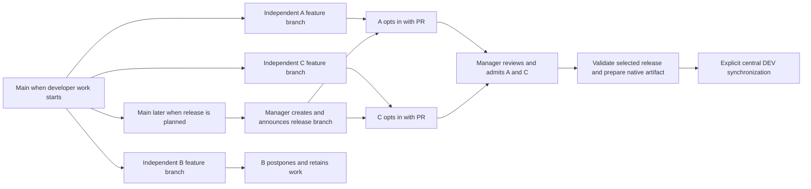

# E.4 — Multi-developer release and central DEV synchronization

Design Approval Status: Accepted

The Product Owner approved this working parallel design on 2026-11-09 and
authorized implementation through handover preparation in the
[implementation handoff](sprint_E.4_implementation_handoff.md). This includes
PBI-060's A/C selection and B deferral criterion refinement. The approval supersedes
the former pending gates below; the earlier review waiver covers design review only.
A new dedicated Astra handover review is required after concrete evidence exists.

The Product Owner selected only PBI-042 and PBI-060. This proposed design follows
[setup/analysis](sprint_E.4_setup.md), [PLAN](../../PLAN.md), the unchanged
[backlog criteria](../../BACKLOG.md) and [SRS](../../docs/srs.md). The
[architecture](../../docs/architecture.md) owns product mechanisms;
[test profile](../../docs/test-profile.md) owns existing checks. This document
owns only the E.4 experiment. This document specifies the approved experiment; actual execution and the approved recovery correction are recorded in [implementation](sprint_E.4_implementation.md) and [tests](sprint_E.4_tests.md).

## Overall architecture and decision

Developers A/B/C work independently in parallel, each with a private author fixture,
Git checkout, feature branch and native connection. They branch from accepted main
when starting their change, record that source revision and develop/export/stage
without a release target or another developer's PR merge. The controlled experiment
uses one common developer start for comparability; it is not the release baseline rule.

The Release Manager later creates a candidate branch from THEN-CURRENT accepted main,
announces its name and invites submissions. Each developer decides whether to join.
A/C opt in through PRs targeting that branch; B elects to postpone and keeps its branch
and work intact. The manager separately reviews submitted PRs and admits A/C after
checks/dependency review. Validate the release branch's inherited main baseline plus
A/C, then follow native release preparation and explicit central DEV synchronization.
No shared author Main checkpoint serializes developer capture. Release selection is
not automatic membership of a sprint or automatic deployment after PR merge.

The [analysis and actor journey](sprint_E.4_setup.md#actor-led-release-participation-journey)
explain responsibilities and failures. Its
[authoritative references](sprint_E.4_setup.md#authoritative-devops-references-and-project-policy)
support GitHub PR targeting, independent branches and release coordination, with
explicit differences from GitHub Flow and Microsoft's mainline-first release model.
Developer opt-in and direct feature-to-release admission are the selected project policy.

This corrects the rejected sequential design. PBI-056 remains excluded: fixed lab
fixtures support this experiment, without implementing a branch-environment request,
provisioning, refresh or retirement service. PBI-019's complete contention/ownership
contract is not assigned, but genuine independent parallel work is mandatory for
this PBI-060 scenario. Broader CI implementation, PR-only release preparation
(PBI-059), clean-host reproduction, quality frameworks and production fencing remain
outside E.4. No broader product requirement is declared complete by this experiment.

## PBI-060 — Present multi-developer SQLcl changes in one release

Status: Accepted

### Requirement Summary

Show three attributable independent developer contributions, separately staged;
select A and C for a numbered native release and preserve B for later delivery.
Explain release selection, postponement, shared changelog coordination and dependency
ordering using actual source changes. The Product Owner approved the A/C-now, B-later refinement and the root PBI-060 criterion was aligned before implementation. The earlier three-in-one wording is superseded; no unchanged-criterion pass is claimed.

### Feasibility Analysis

SQLcl 25.4 documents PROJECT export, stage, verify, release, gen-artifact and
deploy in its [command reference](https://docs.oracle.com/en/database/oracle/sql-developer-command-line/25.4/sqcug/project.html).
The [Oracle lifecycle paper](../../refs/apex-lifecycle-management-v3.pdf) p.20
shows export source committed before stage compares a milestone branch with main;
pp.26–27 show merge, native release, commit/tag, artifact and deployment.
E.3's [corrected native evidence](../E.3/sprint_E.3_release_correction.md) proves
the release/upgrade/repeat slice on the retained target. This supports feasibility,
not a claim that three-contribution staging has already passed.

APEX Working Copies are not selected as a shared-Main integration mechanism here.
Independent author fixtures must reproduce their recorded developer baseline without exporting another developer's
unaccepted change. Existing E.3's single shared author connection is insufficient.
The native feature-centric lifecycle and actual SQLcl export settings must be
qualified for all three fixtures before execution, rather than assumed from the
previous single-developer experiment.

### Design Overview and Technical Specification

Developer A changes Home explanatory text, B a Hello-page label and C a World-page
label. All three edits are independently implementable against the developer baseline. C does not depend
on A or B merging or publishing any code. The final release acceptance depends on
preserving the selected A/C edits together and proving B is absent; none of the
selected changes may depend on deferred B. B remains intact for later integration. Do not change business rules, contracts,
saved-user state or existing data. Explain actual native include ordering and shared changelog coordination;
do not invent a database dependency merely to make the example look complex.

### Prepared author fixtures and source identity

Use three fixed independent author fixtures, one per developer, plus the separate
central DEV target. Each author fixture contains the SAME accepted full application
and database definition baseline. Prefer separate prepared Oracle database/PDB
services with identical canonical schema, workspace name/ID, application ID/original
component IDs and APEX patch level, so native export paths and PROJECT metadata do
not need per-developer source-name rewriting. All three services must be independently
addressable; private connection aliases may differ while resolving to the same logical
PROJECT connection name in each developer's private connection store. Credentials
come from authorized operator inputs, never copied retained scratch credentials.

These fixtures are a design prerequisite, not a claim that three matching databases
already exist on this host. Before execution, record actual service identities,
resource capacity, schema/workspace/application identities, source reconstruction
provenance and a clean no-edit native recapture from each fixture against its recorded baseline. If
matching fixtures are unavailable, baseline capture is inconsistent, native app
identity/path mapping is unsupported, or the host cannot run all three together,
report the execution blocker. Do not fall back to a shared author application,
serially reset one fixture, fabricate staging evidence or upgrade SQLcl silently.
Any alternative topology must preserve independence and have its source mapping
qualified explicitly before use. No new provisioning service or branch lifecycle
manager is part of this sprint; one-time fixture preparation must remain visible.

The known ORA-20860 guard prevents treating the E.3 archive as a generic fresh-fixture
installer. Do not run it against arbitrary new schemas and expect success. The
operator must supply author fixtures reconstructed through the existing supported
native source/import setup, with actual baseline evidence; where that cannot be
done, record the missing setup as a blocker before starting the parallel exercise.
Do not copy runtime business data or alter a released historical changeset to bypass
the guard. Central DEV keeps the already qualified E3_TARGET upgrade/repeat path.

### Independent development and release announcement protocol

Identify corrected seed/controller/source provenance and each developer's accepted
starting main commit. For the controlled parallel fixture, pin a common developer
baseline in each checkout; it is only a native comparison reference. Use e4-a, e4-b
and e4-c as independent feature branches. Slashless demo names avoid E.3's observed
native path problems. Check the actual approved SQLcl release/build against the
Git state being processed before every native operation, including later candidates.

Each developer independently edits/tests their page, exports source with PROJECT,
reviews/commits that source, stages against its recorded immutable comparison base,
reviews/commits native distribution metadata and verifies. Retain original heads,
source/distribution diffs, native transcripts, fixture/participant identity and timestamps
showing overlapping work. Do not infer human concurrency solely from Git author labels.
For this experiment, retain all three original staged results before integration to
prove independent work and B preservation. This evidence checkpoint is not a general
policy that a release must wait for nonparticipating B to finish.

At a later point the Release Manager creates the release branch from current accepted
main, not from the developer comparison reference. Use a slashless example name such
as release-e4-candidate, identifying the real name/version at execution. Record its
actual starting commit. The main revision can have advanced since developers began;
no manual identification of their old shared start is needed to create the branch.
Git ancestry and recorded source revisions provide the comparison history.

Announce the branch in a GitHub release-planning issue, with intended release identity,
branch name and submission/review expectations. This is a proposed operating step;
no announcement is sent while preparing this design. A/C record that they intend to
participate; B elects to wait. Developers opting in create PRs with their feature branch
as head and the announced release branch as base. They need the name to submit that
release PR, not to begin work. B need not open a PR targeting a release it skips.
Any earlier general feedback PR is separate from release admission; retargeting one
requires renewed diff/check review rather than assuming its old approval transfers.

### Integration of independent staged changes

The Release Manager reviews each submitted A/C PR's source, native distribution,
checks and dependencies and decides admission, correction or deferral. Volunteering
does not guarantee acceptance. Merge admitted A/C PRs into the RELEASE BRANCH, not
directly into main. B's feature branch/fixture/source/staged work remain intact and
unmerged. No release admission decision is required for an unsubmitted B change.

The candidate contains its main baseline at creation plus admitted changes. If main
has advanced since developers branched, selected feature branches must reconcile and
revalidate against the actual release branch. Preserve the independent original staged
heads, but do not reuse their check results for new resolved bytes. Later main changes
are not automatically part of this candidate: importing newer main requires explicit
content review and fresh validation. If deferred B is already in the inherited release
baseline, branch creation cannot exclude it; stop and report the scope conflict.

All three edits may touch the same generated full-application export, snapshot or
next changelog even though their logical pages differ. Review those shared files
semantically; choosing one entire side or one developer's full export can silently
remove the others. Combine only A/C page intents using the native source structure,
review the full APEX export/controller and snapshots, and preserve/include each
required distribution change once in the correct order. Do not export an unchanged
single developer fixture over the integrated source. If the native tool needs a
recapture/restage of the combined application, reconstruct it in a separate integration
fixture from the reviewed combined source, then qualify and record that native step;
never turn it into a prerequisite for the original independent authoring/staging.
Do not hand-invent internal snapshot formats or patch private APEX repository tables.

Inspect actual next include graph, changeset IDs/author fields, paths and native
installer behavior. The experiment must explain observed conflicts and how the
resolution retains both selected changes and excludes B. Resolve and reverify an
actual conflict,
while a conflict-free result is reported honestly without claiming arbitrary conflict
safety. Stop on lost intent, duplicate/missing includes, unexplained generated changes
or unsupported native reconciliation. Three staged branches alone do not prove the
final artifact contains the inherited release baseline plus selected A/C and excludes
B. The combined native candidate and browser behavior must establish that. No accepted migration history is rewritten.

Existing E.3 wrappers hard-code e3-base and lab-dev-c. They must not be reused unchanged
as evidence of the three-fixture protocol. After approval, expose the native operations
and adapt only the necessary connection/base inputs; every SQL invocation in the
walkthrough includes complete source and explanation. The [SQLcl PROJECT reference](https://docs.oracle.com/en/database/oracle/sql-developer-command-line/25.4/sqcug/project.html)
defines the comparison-branch semantics; PROJECT stage is not a merge engine.

### Postpone B at the Git integration boundary

On the qualified SQLcl 25.4 toolchain, PROJECT stage generates distribution deltas
against its comparison branch; it is not release selection by developer. Retain B's
captured source, original staged distribution and feature branch; do not merge them
into this candidate. The release branch contains its accepted main baseline plus A/C
src, snapshots and next includes. B can keep an earlier feedback PR open, but does not
need a release-admission PR for a release it skips. Never merge B's source and
merely remove its changelog include: a generated full APEX export can still carry
B's page change into an A/C artifact.

Freeze/package the accepted baseline-plus-A/C Git state. Inspect all application source,
snapshots, includes and archive members, and observe central DEV: A's Home and C's
World edits are present; B's deferred Hello edit is absent relative to the release
baseline. If A or C depends on B, stop
selection and report that dependency; postponement cannot make an invalid subset safe.
If B is already in the inherited release baseline, this simple path no longer applies: prepare
and review an A/C-only release branch or an explicit source/distribution reversal.
Do not claim PROJECT stage will remove B automatically.

When a later release is announced and B opts in, retain its original contribution,
update its branch against that announced release branch, resolve conflicts while preserving
A/C, refresh B's author fixture from the reviewed combined source if recapture is
needed, and rerun appropriate native staging/verification. Inspect existing staging
metadata first: do not blindly duplicate B's old changesets or rewrite previously
released changesets. B submits a PR to that later announced branch; review/merge it
through the normal admission path and create a later
numbered release from the newly accepted state. Original developer-stage evidence is provenance,
not qualification of the later combined revision. Later B delivery is the documented
continuation; it is not automatically executed as part of the first A/C release.

[SQLcl 25.4 PROJECT](https://docs.oracle.com/en/database/oracle/sql-developer-command-line/25.4/sqcug/project.html)
documents no release include/exclude selector. Oracle introduced selective include/
exclude options in PROJECT release in
[SQLcl 26.1](https://docs.oracle.com/en/database/oracle/sql-developer-command-line/26.1/sqcug/changes-release-26.1-oracle-sqlcl.html).
That is release functionality, not PROJECT stage, and is not selected for E.4:
the approved 25.4.1 build remains pinned under NFR-5. No implicit upgrade is authorized.

After A/C admission, review the candidate's complete baseline-plus-selected source,
next include graph and check results. Open a release-branch-to-main PR and validate
its actual merged result. This is candidate promotion, distinct from A/C's feature
PRs. If main advanced after the candidate was assembled, review every resulting
difference: packaging a merged main state must not introduce unselected changes.
Unexpected extra source or distribution content blocks publication until the accepted
release scope and candidate qualification are reconciled. Do not quietly replace
the selected artifact with a package of whatever happens to be on main.

After accepted promotion, use the inherited E.3 release-on-main prototype exception:
PROJECT release freezes next into a new, unused numbered version; review/commit
its metadata/distribution before tagging and generating the artifact. PBI-059
remains unscheduled; do not add a new PR-only release preparation mechanism.
Choose the next unused version from actual repository/native metadata during
execution; never move a historical tag. Package the frozen clean source and
retain SHA-256 plus the exact source commit and native version. PR merges do not
automatically deploy. One explicit operator action admits deployment.

### Error Handling and Implementation Approach

Unknown identity, incompatible SQLcl release/build, dirty release source, unexpected
exported edits, missing includes, unreviewed dependency or native verification errors
stop the journey. Preserve source and diagnostics; no automatic target repair or
scratch cleanup is selected. No source/distribution mutation occurs on a toolchain
mismatch. Missing configured access is a blocker, not authorization to widen grants.

After approval, first rehearse native comparison/stage on disposable Git checkouts
without target deployment. Then execute A/B/C's actual native capture and GitHub
integration journey, freeze/package the combined release and run PBI-042's admission
and synchronization checks. Tests below define the evidence for completion.

## PBI-042 — Synchronize central development after accepted merges

Status: Accepted

### Approved controlled-restoration correction — 2026-11-09

Execution disproved the exact-checksum restoration assumption below. After restoring
only the controlled Home title, the full native source diff contained only
`p_version_scn` changing from 6207684 to 6208968, while CHECKSUM-SH256 also changed.
The Product Owner explicitly answered **“Approve reviewed counter-only recovery.”**
For this controlled test, review the complete raw diff, require exact restored page
content and unchanged business fields, then record a new two-read baseline with the
old receipt and precise counter difference retained. This is a reviewed recovery,
not a silent checksum replacement or broad normalization rule. Any other source
difference remains blocked. The original equality assertion below records the
tested hypothesis; this approved correction governs resumption. Evidence is
[the raw difference](tests/postbaseline-restoration.diff) and
[the recovery receipt](tests/trusted-recovered-baseline.json).

### Requirement Summary and Feasibility Analysis

Reflect the accepted integrated revision in central DEV, identify stale candidates
and preserve unexported edits when synchronization is unsafe. Native PROJECT deploy
installs the archive; it does not itself prove target cleanliness or freshness.
APEX 24.2's public [GET_APPLICATION](https://docs.oracle.com/en/database/oracle/apex/24.2/aeapi/GET_APPLICATION_Function.html)
provides CHECKSUM-SH256 for metadata comparison across identities. This fingerprint
does not cover schema definitions or business rows. The three chosen changes affect
only APEX page metadata, so no general schema drift claim is made.

### Design Overview and Technical Specification

Use the existing supported E3_TARGET / application 810203 as the separate central
DEV role for this experiment, subject to identity/baseline preflight. Keep retained
UAT and other applications out of scope. Use the prepared supported upgrade path;
E.3's ORA-20860 initial-install restriction makes an arbitrary fresh target unsuitable.
The operator must confirm no other active user or author is changing this target.
Participants remain excluded through an explicit no-user/no-author operating
interval. Native availability is observed separately: import can restore the
source AVAILABLE status before restriction is reapplied. This design makes no
continuous technical-denial, multi-worker fencing or atomic-lock claim.

### Trusted baseline qualification

Before any candidate installation, identify the last successfully installed accepted
source/archive from the retained receipt and verify its actual committed archive
hash. The E.3 receipt has no application checksum/profile: its source identity alone
cannot attest to today's live metadata. Never promote the first observed checksum
to authority merely because its source label matches that receipt.

First look for retained trusted checksum evidence bound to that exact target,
source/archive, options and observed availability. If it is absent, perform a
read-only first-run reconciliation: capture the current target's full application
source into private diagnostic output and compare it with the APEX source actually
installed by the verified accepted archive. Preserve both raw exports, raw diff and
reviewed difference explanations. Use the same native export profile, including
original IDs and no export timestamp. Explain each target ID/workspace/schema/alias,
fixed import offset and known deployment setting difference using the committed
mapping/installer and actual target identity; record exact fields and values in the
reconciliation evidence. Do not apply broad text filtering or normalize business
logic, labels, regions, unknown metadata or all availability differences away.
Generated ordering/format differences also require an explicit explanation rather
than an assumed clean result. If equivalent source cannot be established with the
available exports, or any difference is unexplained, preserve pending work, block
PBI-042 execution and request a reviewed reconciliation decision. Do not reinstall
the old archive, reset the target or adopt the current export as accepted source.

Only after all differences are explained and reviewed may the operator bind the
first trusted baseline to target identity, accepted source/archive hash, exact
APEX checksum/export options and actual available-state setting. Obtain two
unchanged CHECKSUM-SH256 reads under coordinated exclusion. Persist that approved
baseline privately between attempts, with a redacted evidence receipt; subsequent
admission compares to it and never recaptures current content as authority. Retain
all current history/configuration fields separately for preservation comparisons.
Test an unexpected edit already present before baseline qualification: it must stop
qualification and remain intact. This prevents the later IT-3 fixture from being
the only pending-work test.

The admission record contains selected accepted Git revision, selected archive hash,
current central DEV receipt/source, current live checksum, decision and reason.
The operator checks that the candidate is the current selected accepted integrated
revision from the admitted release candidate and promotion, not an older PR/head/tag.
Main advancing alone does not silently redefine the selected release. If changes affect
the candidate or promotion result, stop and refresh review/qualification as needed. Do not infer freshness from a
version string or assume ancestry alone means current. Re-read selected source and
live checksum immediately before installation under the coordinated no-edit interval.
This is an explicit operator-enforced procedure. Automated enforcement across
racing processes and general FR-13 completion remain unvalidated.

Negative case 1: select an older candidate after a newer accepted revision exists.
The operator refuses synchronization, records the stale source mismatch and proves
that no PROJECT deploy ran and target definitions/data/receipt remain unchanged.
Negative case 2: make one reversible Page Designer label edit in central DEV after
its recorded baseline. Observe a checksum change; refuse synchronization, retain
the diagnostic export/diff and prove pending edit, data and prior receipt remain.
Restore only that controlled fixture property after capturing preservation evidence;
require the original checksum before resuming. Never reset the application or silently
adopt unexpected live content as accepted Git source.

### Availability, deployment and receipt lifecycle

Positive case: with current accepted artifact and trusted clean target, retain the
available-state baseline and enter coordinated participant exclusion. Observe actual
status/checksum, apply the existing native restriction, then observe status/checksum
again. Native PROJECT deploy may import AVAILABLE from the artifact; observe actual
status immediately afterward and reapply restriction before verifier checks. Do not
claim this prevents requests during import. The coordinated exclusion is the bounded
operating prerequisite. Keep all nonparticipating users and authors out until the
operator releases that interval.

Run read-only readiness/session checks while restricted, verify A/C's selected page
changes and absence of B's deferred label as the permitted verifier and compare every retained history/configuration
field. The inherited accept.sql combines checks with publication: split those
responsibilities for the experiment after design approval, using documented APEX
status APIs, so publication cannot precede preservation/acceptance checks. Adapt its
hard-coded heading expectation for A's chosen edit; do not run it unchanged and
expect that it can validate selection or postponement.

Once all checks pass, restore the explicitly selected AVAILABLE state. Observe
actual status and compute the final checksum twice in that state; only then finalize
the successful source/archive/target/checksum/profile receipt. Release coordinated
exclusion after receipt validation. Next admission and safe repeat compare against
this final AVAILABLE-state receipt, never a transient restricted-state checksum.

Rehearsal must measure checksums around restriction, import, renewed restriction
and restoration. Do not assume status is checksum-neutral: retain each observed
value and its state. If status changes affect fingerprints, demonstrate that restoring
the exact known status returns the corresponding expected checksum, with all other
source differences explained. Unknown differences block publication; no broad
normalization or silent rebaselining is permitted. The newly accepted source becomes
the trusted source for the post-success baseline only after its complete source and
behavior checks, restoration and receipt finalization.

On any native failure, preserve evidence and observe/report the actual application
status and checksum. Import may already have restored availability; failure does
not prove restriction persisted. Attempt restriction only through the known supported
API/connection when available, record whether it succeeded, and keep coordinated
participants excluded regardless. Do not claim transactional rollback, success receipt
or readiness. Unavailable access or unexplained partial state blocks further writes
and requires a separately reviewed operator recovery decision. Repeat the same archive
only after a successful finalized receipt, with admission/checks/preservation repeated.

### Integration Notes and Documentation Requirements

PBI-042 depends on PBI-060's accepted combined artifact. Reuse E.3 native scripts
and supported target mappings where valid, with workflow inputs sourced from GitHub
variables/secrets and private files generated in RUNNER_TEMP. The existing author
connection naming does not identify the target: check both explicitly. Do not expand
the retained prepared-host credential exception or persist new settings in scratch.

Provide one reproducible walkthrough and user manual explaining independent parallel work,
release announcement, developer opt-in and manager admission,
three staged deltas, A/C selection and B postponement, include/dependency review,
numbered release, admission, pending-work rejection and central synchronization. At handover produce the normal presentation
pair and live demonstration. Describe actual manual decisions separately from automated
steps. Store only redacted receipts/logs/screenshots; business snapshots stay private.
The [documentation audit](sprint_E.4_documentation_audit.md) tracks consistency and
approval dependencies.

### Testing Strategy

#### Recommended Sprint Parameters

Test: smoke, integration. Smoke checks native project integrity and source/artifact
identity; integration executes the actual A/B/C journey and synchronization procedure.
Regression: smoke, limited to the existing supported native pipeline slice. This
replaces the earlier broad E.4 default; no production logic or new custom state machine
is selected, so unit tests and full historical E.1 integration regression add no
experiment evidence here. If implementation requires material new decision logic,
revise the design/test scope before coding it.

#### Unit Test Targets

None selected. Operator decisions and native operations are exercised directly.
No new framework, synthetic success fixture or test mirroring a helper is required.

#### Integration Test Scenarios

Three developers work in parallel on separate prepared author fixtures,
with real GitHub PR/merge evidence and actual independent native exports/stages.
Record all three staged original heads before the first integration, then test the
resolved baseline-plus-A/C candidate and prove B is excluded/intact. Exercise branch
creation from later main and separate developer participation from manager admission. Follow with stale-candidate
refusal, pending-live-edit refusal, clean combined deployment and safe repeat. Keep
rejection snapshots separate from deployment evidence. Infrastructure is the existing
Oracle/APEX/ORDS host, qualified SQLcl/Java and authorized GitHub operator repository.
Elapsed runtime is unknown until rehearsal; record observed duration and operator effort.

#### Smoke Test Candidates

Preflight identities/toolchain; native PROJECT verify after staging/integration/release;
frozen version/source/archive binding. Use current selected E.4 evidence. Historical E.3
artifact readers can support regression context but cannot pass E.4 acceptance.

## Test Specification

All cases below are specified and initially unrun. Product Owner approval is recorded
above; actual execution outcomes belong in the implementation and test records.
After approval register only useful automated assertions in existing pipeline-domain
test files/manifests; retain native/manual experiment steps as explicit evidence.

### SM-1 — Identity and native integrity

Check actual SQLcl release/build against selected project metadata before any export,
stage, verification, packaging or target operation. Verify expected author/target identity
and clean release source. Native PROJECT verify must pass with no errors, with warnings
explained. Wrong tool release, wrong target or missing baseline blocks before mutation.
Targets: existing pipeline-domain smoke checks and retained native transcripts.

### IT-1 — Three contributions and one release (PBI-060)

Precondition: three qualified independent author fixtures/checkouts/identities and
supported native toolchain. Developers start independently from accepted main; the
controlled fixture uses a common starting revision and records each branch/base.
Capture overlapping authoring/export/stage work with no waiting for another PR merge.
Retain all three original staged heads and B's private work as experiment evidence.

Later create the release branch from then-current accepted main and record its actual
SHA; demonstrate a later accepted baseline rather than requiring the manager to reuse
the developer start. Use an existing appropriate later accepted commit or, after design
approval, a reviewed harmless fixture change to establish the distinction. Include the
inherited baseline intentionally; do not assume the release contains only A/C deltas.
Retain the announcement identifying the candidate branch and submission expectations.

Record A/C opting in through PRs targeting that announced branch and B electing to
wait without merging its change. The manager reviews/admits A/C after required checks;
if a submitted contribution fails readiness/dependencies it cannot be merged merely
because its developer volunteered. Reconcile against the actual release baseline,
resolve shared native source/snapshot/changelog changes and verify the combined
candidate. Retain original provenance and fresh resolved-revision check evidence.

Promote the validated release candidate through its PR to main, inspect any extra
mainline changes and qualify the actual accepted release source. Freeze one numbered
native release and package its committed clean source. Inspect source, snapshots,
include graph, archive and browser behavior: inherited release baseline and A/C must
be present, B absent, and B's original work intact. Document B opting into a later
announced release and revalidating against that branch. Runtime cases remain unrun.

### IT-2 — Stale synchronization refused (PBI-042)

Supply the older accepted candidate after the newer combined revision is selected.
Pass requires a recorded refusal for source mismatch, no deployment invocation and
unchanged live checksum, data and previous receipt. A failed connection is not a pass.
This checks operator procedure, not an autonomous stale-worker guard.

### IT-3 — Unexported work preserved (PBI-042)

First qualify the initial baseline, including an unexpected pre-existing edit that
must block qualification without deployment or silent adoption. Restore only that
explicit fixture property and complete the reviewed reconciliation/two-read check.
Then save a controlled central DEV Page Designer label edit after qualification, attempt
admission, observe checksum mismatch and refuse deployment. Pass requires that the
edit still exists, diagnostic source is retained privately, and business fields and
prior receipt are unchanged. Restore the exact fixture edit explicitly, then require
baseline checksum equality before the positive case. Unknown differences stay blocked.

### IT-4 — Combined synchronization and repeat (both PBIs)

Admit the current accepted numbered artifact on the clean supported target, deploy it,
verify readiness/session, inspect A/C's selected page changes and require B's
Hello label to match the selected release baseline rather than its deferred edit. Compare every baseline
history/configuration field, record actual source/hash/target/tool identities, then repeat
the same archive and the checks. Observe actual status/checksum at each restriction,
import and restoration transition. Finalize the checksum receipt only in the restored
AVAILABLE state; subsequent repeat must use that trusted receipt without rebaselining.
Failure instructions observe actual state and retain coordinated exclusion. Pass requires visible combined intent and preserved
fields after both installs. App version-footer stamping, arbitrary initial install,
saved-report reconstruction and general DDL recovery are not claimed.

### Traceability and exit

PBI-060 maps to SM-1, IT-1 and IT-4; PBI-042 maps to SM-1 and IT-2/3/4. Each parent
is one bounded reviewable increment; no child decomposition is needed for independent
value or deferral. Approval authorizes construction for both parents. Passing E.4
requires actual native and browser observations, not only checks reading old receipts.
Record any unmet acceptance outcome as open rather than replacing it with a narrative.
The approved PBI-060 criterion now requires A/C-now, B-later; the root backlog has
been aligned without changing its ID, priority or assignment.

## Review and approval

The Product Owner rejected the sequential authoring design and requires all three
developers to work independently in parallel, then opt into a later announced release
branch created from current main. The release baseline need not equal their start. The earlier
[Astra report](sprint_E.4_design_review-1.md) and
[feedback](sprint_E.4_design_review-1-feedback.md) reviewed the superseded sequential
scenario; their adequacy verdict does not validate this corrected parallel design.
Their R1-M1/R1-M2 baseline/availability corrections remain in PBI-042.

The Product Owner waived another design review, then approved this revision and
authorized implementation, fixture qualification and the native/GitHub experiment.
The requested dedicated Astra handover review follows concrete implementation/test
evidence. The [assessment](sprint_E.4_assessment.md) records current execution readiness.
