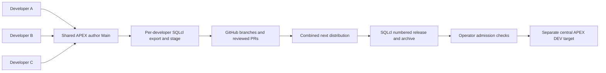

# E.4 — Multi-developer release and central DEV synchronization

Design Approval Status: Awaiting Review

The Product Owner selected only PBI-042 and PBI-060. This proposed design follows
[setup/analysis](sprint_E.4_setup.md), [PLAN](../../PLAN.md), the unchanged
[backlog criteria](../../BACKLOG.md) and [SRS](../../docs/srs.md). The
[architecture](../../docs/architecture.md) owns product mechanisms;
[test profile](../../docs/test-profile.md) owns existing checks. This document
owns only the E.4 experiment. No implementation or native execution is claimed.

## Overall architecture and decision

Use the existing shared APEX author Main, three developer identities and three
Git checkouts. Coordinate distinct authoring/capture windows so each contribution
is attributable; integrate each staged branch through GitHub PR review. Accumulate
all three in dist/releases/next, freeze one numbered SQLcl release, generate one
archive and explicitly synchronize the separate prepared central DEV target.
Working Copies can isolate supported page edits before their coordinated merge
into author Main; they are not Git branches or schema isolation. Git remains the
release source authority. Author Main and central DEV are separate application
identities, even on the same host.

This is the coordinated shared-development pattern with multiple attributable
native staging contributions. It deliberately does not select the full private
feature-instance topology from paper pp.32–39 or validate PBI-019 contention.
PBI-056, broader CI implementation, PR-only release preparation (PBI-059), clean
host reproduction, quality frameworks and production fencing remain outside E.4.
No existing product requirement is declared satisfied solely by this experiment.

## PBI-060 — Present multi-developer SQLcl changes in one release

Status: Proposed

### Requirement Summary

Show three attributable developer contributions, separately staged, integrated
and validated together, delivered in one numbered native release. Explain shared
changelog coordination and dependency ordering using actual source changes.

### Feasibility Analysis

SQLcl 25.4 documents PROJECT export, stage, verify, release, gen-artifact and
deploy in its [command reference](https://docs.oracle.com/en/database/oracle/sql-developer-command-line/25.4/sqcug/project.html).
The [Oracle lifecycle paper](../../refs/apex-lifecycle-management-v3.pdf) p.20
shows export source committed before stage compares a milestone branch with main;
pp.26–27 show merge, native release, commit/tag, artifact and deployment.
E.3's [corrected native evidence](../E.3/sprint_E.3_release_correction.md) proves
the release/upgrade/repeat slice on the retained target. This supports feasibility,
not a claim that three-contribution staging has already passed.

APEX 24.2 [Working Copies](https://docs.oracle.com/en/database/oracle/apex/24.2/htmdb/about-working-copies.html)
merge at page/component granularity and have unsupported component types. Keep
the selected changes to supported page content. No deletion, translation, theme,
workspace-level change or supporting-object migration is selected.

### Design Overview and Technical Specification

Developer A changes the Home explanatory text to identify the combined exercise.
Developer B changes a Hello-page explanatory label. Developer C changes a World-page
explanatory label referring to the Hello/World combined workflow. Do not change
business rules, version contracts, saved-user state or existing data. C's review
must explicitly require A and B's accepted source before final qualification;
this is an integration/release dependency, not a fabricated database DDL dependency.
The walkthrough explains that real schema dependencies would require reviewed
DDL ordering before dependent APEX import, but does not claim to test that path.

Before the first authoring window, confirm the actual baseline source, author Main
identity, central DEV identity, schema connections and approved SQLcl build. Reuse
the corrected local bundle, not the potentially older remote seed. Record exact
bundle/controller/source identities. New branches use slashless names such as
e4-a, e4-b and e4-c because E.3 observed native problems with slash-containing paths.

For A, record an immutable local comparison branch at accepted main before edits.
A authors/checks the page, then runs native export in A's checkout; inspect and
commit source before native stage compares against that recorded base. Review
and commit the generated distribution and metadata. Open/review/merge A's PR.
B updates from accepted main including A, records B's new comparison base and
repeats for B's page. C repeats from accepted main including A/B. Prior accepted
changes remain in B/C's base; each developer's source delta must contain only
that developer's intended edit and explained native bookkeeping. If an export
contains unaccepted work, stop and preserve it rather than assigning its authorship
to the current developer. Capture windows close only after review of the diff.

The native command interface is PROJECT export (list then export), PROJECT stage
with the explicit recorded comparison branch, and PROJECT verify with its explicit
comparison branch where required. Every capture/stage transcript records branch,
full base/head SHAs, schema/application mapping, actual SQLcl release/build,
changed paths, generated includes and errors/warnings. The command reference's
stage branch option identifies the comparison base; it is not a developer label.
Existing E.3 wrappers hard-code e3-base and lab-dev-c: do not reuse them unchanged
or pretend they already support these three captures. After approval, expose the
native operations in the walkthrough and adapt only the necessary connection/base
inputs. Every SQL invocation must include its complete source and explanation.

Inspect the accumulated next changelog and its include graph after each merge.
Retain changeset IDs, author fields, referenced paths and order; no accepted
migration history is rewritten. If native staging replaces a prior page changeset,
prove the resulting full application includes A/B/C and explain which intermediate
checkpoint is superseded. Stop if it loses a required contribution or references
missing sources. Do not claim three staged commits necessarily imply three
separately executed application imports: inspect what the actual native installer
does. A real generated-file conflict requires review of both intents and native
verify after resolution. Absence of a conflict is a measured result, not proof
of arbitrary conflict safety.

After the final accepted contribution, review the complete source and next
include graph. Use the inherited E.3 release-on-main prototype exception:
PROJECT release freezes next into a new, unused numbered version; review/commit
its metadata/distribution before tagging and generating the artifact. PBI-059
remains unscheduled; do not add a new PR-only release preparation mechanism.
Choose the next unused version from actual repository/native metadata during
execution; never move a historical tag. Package the frozen clean source and
retain SHA-256 plus the exact source commit and native version. PR merges do not
automatically deploy. One explicit operator action admits deployment.

### Error Handling and Implementation Approach

Unknown identity, incompatible SQLcl release/build, dirty release source, unexpected
exported edits, missing includes, unreviewed dependency or native verification errors
stop the journey. Preserve source and diagnostics; no automatic target repair or
scratch cleanup is selected. No source/distribution mutation occurs on a toolchain
mismatch. Missing configured access is a blocker, not authorization to widen grants.

After approval, first rehearse native comparison/stage on disposable Git checkouts
without target deployment. Then execute A/B/C's actual native capture and GitHub
integration journey, freeze/package the combined release and run PBI-042's admission
and synchronization checks. Tests below define the evidence for completion.

## PBI-042 — Synchronize central development after accepted merges

Status: Proposed

### Requirement Summary and Feasibility Analysis

Reflect the accepted integrated revision in central DEV, identify stale candidates
and preserve unexported edits when synchronization is unsafe. Native PROJECT deploy
installs the archive; it does not itself prove target cleanliness or freshness.
APEX 24.2's public [GET_APPLICATION](https://docs.oracle.com/en/database/oracle/apex/24.2/aeapi/GET_APPLICATION_Function.html)
provides CHECKSUM-SH256 for metadata comparison across identities. This fingerprint
does not cover schema definitions or business rows. The three chosen changes affect
only APEX page metadata, so no general schema drift claim is made.

### Design Overview and Technical Specification

Use the existing supported E3_TARGET / application 810203 as the separate central
DEV role for this experiment, subject to identity/baseline preflight. Keep retained
UAT and other applications out of scope. Use the prepared supported upgrade path;
E.3's ORA-20860 initial-install restriction makes an arbitrary fresh target unsuitable.
The operator must confirm no other active user or author is changing this target.
The application remains unavailable during the controlled synchronization interval;
this is coordination, not multi-worker fencing or an atomic deployment lock.

Before any candidate deployment, retain a private baseline of current target
metadata checksum, installed source identity, existing history/configuration fields
and actual application status. Verify baseline identity against the last successful
receipt; missing or unexplained baseline evidence blocks the run. Capture current
metadata into a separate diagnostic location for review, never over canonical src.
Use identical documented checksum options for before/after comparisons.

The admission record contains selected accepted Git revision, selected archive hash,
current central DEV receipt/source, current live checksum, decision and reason.
The operator checks that the candidate is the current selected accepted integrated
revision, not an older PR/head/tag; if main changes after selection, stop and record
whether the release selection must be refreshed. Do not infer freshness from a
version string or assume ancestry alone means current. Re-read selected source and
live checksum immediately before installation under the coordinated no-edit interval.
This is an explicit operator-enforced procedure. Automated enforcement across
racing processes and general FR-13 completion remain unvalidated.

Negative case 1: select an older candidate after a newer accepted revision exists.
The operator refuses synchronization, records the stale source mismatch and proves
that no PROJECT deploy ran and target definitions/data/receipt remain unchanged.
Negative case 2: make one reversible Page Designer label edit in central DEV after
its recorded baseline. Observe a checksum change; refuse synchronization, retain
the diagnostic export/diff and prove pending edit, data and prior receipt remain.
Restore only that controlled fixture property after capturing preservation evidence;
require the original checksum before resuming. Never reset the application or silently
adopt unexpected live content as accepted Git source.

Positive case: with current accepted artifact and clean target, explicitly call
native PROJECT deploy on that archive. Run native readiness/session checks, inspect
A/B/C's three visible page changes in the browser, and compare all retained baseline
history/configuration fields. Record the new source/archive/checksum receipt only
after success, then restore the intended application availability. Reapply the same
archive once and verify unchanged fields and all three changes. A native failure
keeps the target unavailable and retains evidence; do not restore readiness or claim
transactional rollback after committed DDL/import. Recovery requires a separately
reviewed operator decision.

### Integration Notes and Documentation Requirements

PBI-042 depends on PBI-060's accepted combined artifact. Reuse E.3 native scripts
and supported target mappings where valid, with workflow inputs sourced from GitHub
variables/secrets and private files generated in RUNNER_TEMP. The existing author
connection naming does not identify the target: check both explicitly. Do not expand
the retained prepared-host credential exception or persist new settings in scratch.

Provide one reproducible walkthrough and user manual explaining coordinated windows,
three staged deltas, include/dependency review, numbered release, admission, pending-work
rejection and central synchronization. At handover produce the normal presentation
pair and live demonstration. Describe actual manual decisions separately from automated
steps. Store only redacted receipts/logs/screenshots; business snapshots stay private.
The [documentation audit](sprint_E.4_documentation_audit.md) tracks consistency and
approval dependencies.

### Testing Strategy

#### Recommended Sprint Parameters

Test: smoke, integration. Smoke checks native project integrity and source/artifact
identity; integration executes the actual A/B/C journey and synchronization procedure.
Regression: smoke, limited to the existing supported native pipeline slice. This
replaces the earlier broad E.4 default; no production logic or new custom state machine
is selected, so unit tests and full historical E.1 integration regression add no
experiment evidence here. If implementation requires material new decision logic,
revise the design/test scope before coding it.

#### Unit Test Targets

None selected. Operator decisions and native operations are exercised directly.
No new framework, synthetic success fixture or test mirroring a helper is required.

#### Integration Test Scenarios

Three developers contribute on the prepared shared author environment, with real
GitHub PR/merge evidence and actual native exports/stages. Follow with stale-candidate
refusal, pending-live-edit refusal, clean combined deployment and safe repeat. Keep
rejection snapshots separate from deployment evidence. Infrastructure is the existing
Oracle/APEX/ORDS host, qualified SQLcl/Java and authorized GitHub operator repository.
Elapsed runtime is unknown until rehearsal; record observed duration and operator effort.

#### Smoke Test Candidates

Preflight identities/toolchain; native PROJECT verify after staging/integration/release;
frozen version/source/archive binding. Use current selected E.4 evidence. Historical E.3
artifact readers can support regression context but cannot pass E.4 acceptance.

## Test Specification

All cases below are specified and unrun. No skeletons/manifests are implemented before
Product Owner approval, as required by local P8 and the explicit design stop boundary.
After approval register only useful automated assertions in existing pipeline-domain
test files/manifests; retain native/manual experiment steps as explicit evidence.

### SM-1 — Identity and native integrity

Check actual SQLcl release/build against selected project metadata before any export,
stage, verification, packaging or target operation. Verify expected author/target identity
and clean release source. Native PROJECT verify must pass with no errors, with warnings
explained. Wrong tool release, wrong target or missing baseline blocks before mutation.
Targets: existing pipeline-domain smoke checks and retained native transcripts.

### IT-1 — Three contributions and one release (PBI-060)

Precondition: identified corrected baseline and three developer identities/checkouts.
Execute A/B/C's three author/capture/source-commit/stage/PR/merge windows in order.
Record exact comparison bases, source and distribution diffs, authorship and include
order. Inspect final source for all three edits, freeze one numbered release and package
from its committed clean source. Pass requires three attributable separately staged
contributions, combined native verification and one archive whose numbered distribution
contains all three intended changes. Browser results are checked after IT-4, not inferred
from Git merges. Explain any generated-file conflict and actual dependency handling.

### IT-2 — Stale synchronization refused (PBI-042)

Supply the older accepted candidate after the newer combined revision is selected.
Pass requires a recorded refusal for source mismatch, no deployment invocation and
unchanged live checksum, data and previous receipt. A failed connection is not a pass.
This checks operator procedure, not an autonomous stale-worker guard.

### IT-3 — Unexported work preserved (PBI-042)

Capture baseline, save a controlled central DEV Page Designer label edit, attempt
admission, observe checksum mismatch and refuse deployment. Pass requires that the
edit still exists, diagnostic source is retained privately, and business fields and
prior receipt are unchanged. Restore the exact fixture edit explicitly, then require
baseline checksum equality before the positive case. Unknown differences stay blocked.

### IT-4 — Combined synchronization and repeat (both PBIs)

Admit the current accepted numbered artifact on the clean supported target, deploy it,
verify readiness/session and inspect all three page changes. Compare every baseline
history/configuration field, record actual source/hash/target/tool identities, then repeat
the same archive and the checks. Pass requires visible combined intent and preserved
fields after both installs. App version-footer stamping, arbitrary initial install,
saved-report reconstruction and general DDL recovery are not claimed.

### Traceability and exit

PBI-060 maps to SM-1, IT-1 and IT-4; PBI-042 maps to SM-1 and IT-2/3/4. Each parent
is one bounded reviewable increment; no child decomposition is needed for independent
value or deferral. Keep both under_design until Product Owner approval. Passing E.4
requires actual native and browser observations, not only checks reading old receipts.
Record any unmet acceptance outcome as open rather than replacing it with a narrative.

## Review and approval

The existing local Astra reviewer will inspect this Proposed design and current
context through the [external review skill](../../.agents/skills/rup-external-review/SKILL.md).
Original expert text, engineering response and dispositions will be retained under this
document's review filename base. Correct design defects before requesting approval.
Expert validation is independent advice; only the Product Owner may accept this design.
No implementation, workflow dispatch, source export/stage or target mutation is authorized
until that approval. The only current deliverable is the reviewed experiment design.
